# Final Report

<!--
The capstone black book, in the format of the NMIMS guidelines (Annexure A.8):
Chapters 1-6, References, Appendices A-D. Front matter (title page,
certificate, acknowledgement, abstract, contents, lists, abbreviations) is
generated by the builder.

Source of truth: this Markdown file. Build the Word version with
    python docs/render_diagrams.py
    python docs/build_docx.py final
    python docs/finalise_docx.py docs/<the built .docx>
Every number quoted here that docs/verify_claims.py knows how to compute is
checked against the running code on every CI run. The interim report
(Review 2) is frozen and is not edited; figures that moved since it are
updated here, with the reason given where it matters.
-->

## Chapter 1: Introduction

Modern banking runs on APIs. A single retail bank exposes hundreds of HTTP
endpoints across mobile banking, internet banking, payments, KYC, partner
integrations and internal microservices. Those endpoints are created quickly and
retired slowly, and a substantial fraction of them are never retired at all. This
report describes API Exorcist, a system that finds endpoints which are still
running but no longer serve any purpose, establishes before anything is switched
off whether removing one is safe, and then carries a removal through observation,
named approval, a staged rollout with automatic rollback, and a tamper-evident
audit trail.

The report is organised as the project was. Chapter 1 states the background,
motivation, scope and problem, and the contribution the project makes. Chapter 2
surveys the literature the design draws on and names the research gap. Chapter 3
presents the methodology and the implementation: the architecture, the execution
environment, the software, the algorithms, the application a security team uses,
and the standards followed. Chapter 4 reports and analyses the measured results.
Chapter 5 sets out the advantages, limitations and applications, and Chapter 6
concludes and describes the scope for future work.

### 1.1 Background of the project topic

An API endpoint has a lifecycle. It is written, deployed, documented, used, and
eventually superseded. The final step, decommissioning, depends on a human
deciding that nothing depends on it any more. That decision is expensive to make
correctly and cheap to postpone, so in practice it is postponed. The endpoint keeps
running. It keeps its database credentials, its network route and its access to
production data, and it stops appearing in anybody's mental model of the system.

The industry has a name for the resulting failure mode. OWASP lists it as
**API9:2023 Improper Inventory Management** in the API Security Top 10 **[13]**,
describing hosts and API versions that remain deployed and reachable while the
organisation's documentation and inventory no longer account for them. The concern
is not hypothetical for Indian banks in particular: the Reserve Bank of India's
*Cyber Security Framework in Banks* **[14]** requires an accurate, maintained
inventory of information assets, and an endpoint nobody knows about cannot be
patched, cannot be monitored, and cannot be included in an audit. NIST's guidance
on securing web services **[15]** makes the same point from the engineering side:
a service that is not inventoried cannot be governed.

Four distinct conditions are conflated under the informal label "old API", and the
project separates them because they demand different responses:

Table: The four lifecycle states the project distinguishes

| Class | Definition | Correct action |
|---|---|---|
| **ACTIVE** | Documented, owned, and carrying meaningful traffic | Leave alone |
| **DEPRECATED** | Declared end-of-life but still serving real callers | Managed sunset with consumer notice |
| **ORPHANED** | Carrying real traffic but with no owning team | Assign an owner, never remove |
| **ZOMBIE** | Reachable, unowned, undocumented, and not meaningfully used | Candidate for removal |

The distinction that matters most is between ORPHANED and ZOMBIE. Both are unowned.
Only one is unused. Removing an orphaned endpoint causes an outage in whatever is
still calling it, and the fact that no team claims it makes that outage harder to
diagnose, not easier. A tool that cannot tell the two apart is not usable in
production.

A related term is the **shadow API**: an endpoint that is served but appears in
neither the organisation's specification nor its gateway registry. A shadow API
may be active or a zombie; what defines it is that the authoritative inventory does
not know it exists. Shadow status is therefore a *visibility* finding and lifecycle
state is a *usage* finding, and the system reports the two separately.

### 1.2 Motivation and scope of the report

The motivation is a gap between what can be detected and what can be safely acted
upon. Static analysis can list the routes a repository defines. A gateway can list
the routes it proxies. Traffic capture can list the routes that were called. Each of
these is a partial and imperfect witness, and each is routinely wrong in a
predictable direction: the gateway does not see a service that is addressed
directly, the specification does not describe a route the team forgot to document,
and traffic capture cannot see a route that nothing called during the capture window.

The central observation of this project is therefore that **a zombie endpoint is not
identified by any single source of evidence. It is identified by a pattern of
disagreement between sources.** An endpoint that the code defines, that DNS
resolves, that the gateway has never registered, that the specification does not
describe, that no pipeline has deployed in a year and that traffic has not seen in
six months is a zombie, and no one of those six facts says so on its own.

The second motivation is that detection alone does not reduce risk. A list of
suspected zombies that nobody dares to act on leaves every one of them running. The
project therefore treats safe removal as part of the problem rather than as a
follow-up: before an endpoint is switched off, the system must predict what would
break, observe for long enough to catch callers that are rare, obtain a named human
decision, and be able to reverse itself automatically.

**Scope of the work reported here.** This report covers the complete system, built
in eleven phases between August and October 2026:

- six independent discovery connectors, each with deliberate, documented blind spots,
  and their correlation into a single inventory carrying fourteen discrepancy flags;
- a four-class classifier built from fifteen weighted evidence rules, which abstains
  rather than guesses when a source was never consulted, with a per-verdict
  explanation carrying every signed evidence contribution;
- a dependency graph with blast-radius computation, backed in-process or by Neo4j,
  and a removal gate that requires the classifier and the graph to agree;
- a labelled dataset generator, a trained gradient-boosted model used as a veto, and
  SHAP attribution rendered through the same explanation objects the rules produce;
- **Safe Kill**, the removal controller: a shadow window derived from the rule of
  three, named approval, a 5% / 25% / 100% canary, automatic rollback, and an
  append-only hash-chained audit log;
- a REST API with hashed bearer tokens and roles, and a React and TypeScript
  dashboard through which a security team runs every part of the system from a
  browser;
- scanning of real projects, uploaded as a folder or fetched from a GitHub link,
  which ranks zombie candidates from the evidence code holds and proves or clears
  them from imported gateway access logs;
- a CI/CD enforcement action that stops new shadow and zombie endpoints being
  merged; and
- a hardened container image, Prometheus metrics, structured logs and a security
  review.

**One boundary is stated here because it governs how every result in Chapter 4
should be read.** The architecture, the connectors, the correlator, the classifier,
the graph, the Safe Kill controller and the evaluation harness are real code, and
the repository scanner reads real public projects. The banking estate on which
lifecycle classification and Safe Kill are *measured* is **synthetic**: a generated
retail-banking microservice estate with a known answer key, because no labelled
corpus of zombie APIs exists and no bank publishes its API inventory. No production
bank data was used, and none was available. The defensible claim, made consistently
throughout this report, is that *the engine recovers known decay patterns from
partial and disagreeing evidence*; it is not, and is never presented as, validation
against live bank traffic. Where a result comes from real code rather than the
simulation, the report says so.

### 1.3 Problem statement

> Banking API estates accumulate endpoints that remain deployed and reachable after
> they have ceased to serve any purpose. No single source of evidence, whether
> gateway registry, API specification, source code, traffic capture, DNS or
> deployment history, can establish whether a given endpoint is genuinely unused,
> because each source has systematic blind spots. Existing tooling therefore either
> misses these endpoints or, worse, flags live endpoints for removal. Furthermore,
> the tools that do detect anomalous endpoints stop at detection: they produce a
> report, and the decision to decommission remains an unaided human judgement made
> without knowing what depends on the endpoint. The problem is to determine an
> endpoint's true lifecycle state by correlating multiple partial sources, to
> quantify the consequence of removing it, to remove it only in a way that is
> observable and reversible, and to make every classification and removal decision
> explainable enough to be defended in a regulated audit.

Four sub-problems follow, and the project is organised around them:

1. **Determination under partial evidence.** Establish lifecycle state from sources
   that disagree, and, critically, distinguish *"this source says no"* from
   *"this source was never asked"*. A system that treats an unconsulted source as
   negative evidence will confidently mislabel a live estate.
2. **Consequence prediction.** Before an endpoint is cleared for removal, determine
   what calls it, transitively, and refuse to clear anything with dependants.
3. **Safe action.** Remove an endpoint only after an observation long enough to
   catch rare callers, with a named approval, a staged rollout and automatic
   rollback, so that a wrong decision is caught before it becomes an outage.
4. **Auditability.** Every classification and every removal decision must carry the
   complete evidence that produced it, in a form a compliance reviewer can read, and
   the record of decisions must be tamper-evident.

**Objectives.** The project set itself the following objectives, against which
Chapter 4 reports:

1. Correlate six discovery sources into one inventory and classify every endpoint
   into the four lifecycle states, abstaining where evidence is missing.
2. Find more of an estate's zombies than a conventional gateway-plus-specification
   inventory does, without ever marking a live endpoint for removal.
3. Answer the review panel's requests: identify a defensible dataset for the
   learned model, focus the work on one application domain (retail banking), and
   make the automated decisions explainable.
4. Make removal safe: predict blast radius, and measure how often the removal
   process would have caused an outage, against removal on the classifier's word.
5. Work on real code, not only on the simulation, and deliver the system in a form a
   bank's security team could install and operate.

### 1.4 Salient contribution

The individual capabilities the project relies on exist in the literature. The
contribution is their composition, plus five specific design decisions that the
survey in Chapter 2 did not find combined anywhere:

1. **Absence treated as first-class evidence, with abstention.** The inventory
   records which sources did *not* observe an endpoint, and each evidence rule
   declares which sources it needs. A rule whose source was never consulted abstains
   instead of firing. This is what makes a partial deployment honest: scanning only a
   repository yields six of fifteen usable rules and the system reports that it
   cannot make a lifecycle claim, rather than declaring every endpoint dead.
2. **A removal gate requiring two independent agreements.** An endpoint is cleared
   only when the evidence classifier calls it a zombie *and* the dependency graph
   finds it has no callers. Either alone is insufficient, and the project's tests
   assert that no live endpoint is ever marked for removal.
3. **A learned model used as a veto, never as a proposer.** The rule layer is what
   allows a new deployment to work on day one with zero training data, and it is
   auditable line by line. The trained model, evaluated separately on held-out
   estates, is close to the rules in aggregate but produces zero false zombies where
   the rules produce fourteen. It is therefore permitted to *block* a removal and
   never to *create* one, an asymmetry chosen because a false zombie is an outage
   and a missed one is a line on a report.
4. **A shadow kill before any canary, with a window derived rather than chosen.**
   Measurement showed that the endpoints which reach the removal stage carry too
   little traffic for a percentage canary to notice anything. The design's
   "simulated" stage was therefore built as a *shadow* in which nothing is refused
   and every request that would have been is recorded, for a length fixed by the
   rule of three: ninety days catches a monthly caller with 95% confidence. Across
   generated estates this takes removal on the gate's word from forty-nine outages
   to none.
5. **Evidence that stays honest on real code.** A repository holds no usage data, so
   a repository scan never labels an endpoint a zombie. It ranks *candidates* from
   the evidence code does hold (a newer version beside an old one, the project's own
   clients calling only the newer one, deprecation markers, debug routes) and proves
   or clears them from imported gateway access logs under three guards against
   over-reading silence.

A sixth contribution is methodological. The synthetic estate is generated **by
lifecycle mechanism rather than by label rule**: an endpoint is put through a story,
a product is discontinued, a team dissolves, a migration stalls, a debug route
outlives an incident, and its observable features are consequences of that story.
Three guards enforce, at import and token level, that the ground-truth fields never
reach detection code. They were written after an early connector was found deriving
a feature from the answer key, which would have silently inflated every reported
figure.

### 1.5 Organization of the report

**Chapter 1** states the background, motivation, scope, problem, objectives and
contribution. **Chapter 2** surveys the literature across six themes (dead-code
detection, architecture recovery through static analysis, graph-based dependency
modelling, security smells and the detection-remediation gap, explainability in
security decisions, and passive discovery), traces each finding to the module that
implements it, and names the research gap. **Chapter 3** presents the methodology
and implementation: the block diagram, the execution environment and technology
stack, the software, the algorithms with pseudo-code, how a repository is scanned,
how classification and Safe Kill are used in the application, its deployment, and
the standards followed. **Chapter 4** reports the evaluation: classification
quality, the comparative study, the learned model, the removal gate, Safe Kill,
scans of eight real repositories and their validation, a comparison of the
position with and without the system, and engineering quality. **Chapter 5**
sets out advantages, limitations and applications, and **Chapter 6** concludes and
describes future work. The appendices hold the algorithm flowcharts, data sheets for
the rules, features and interfaces, the list of software components, and the status
of the research paper.

**Summary.** Banking API estates accumulate endpoints that are still reachable but
no longer serve any purpose, and no single evidence source can identify them because
every source has systematic blind spots. This chapter has defined the four lifecycle
states the project distinguishes, stated the problem as determination under partial
evidence followed by consequence prediction, safe action and auditable explanation,
set out five objectives, and fixed the boundary between what is real and what is
simulated.

---

## Chapter 2: Literature Survey

This chapter reviews the research the project builds on. It is organised by theme
rather than by paper, because the argument the project makes is cumulative: each
theme supplies one necessary component, and the gap the project addresses is that
nobody has assembled them. Section 2.1 introduces the overall topic. Sections 2.2
to 2.7 survey the six themes across twelve peer-reviewed sources. Section 2.8
traces every finding to the design decision it justifies and the module that
implements it. Section 2.9 states the research gap and how the problem statement
follows from it. Section 2.10 records which citations were verified against full
text, and what that verification changed.

### 2.1 Introduction to the overall topic

The topic sits at the intersection of three research communities that rarely cite
each other. Empirical software engineering studies *dead code*, code that is
present in a system but never executed, and has established both its prevalence and
its evolution over time **[1]**, and the inconsistency with which deprecation is
declared **[2] [11]**. Microservice architecture research studies *architecture
recovery*, the problem of reconstructing a system's true structure from its
artefacts because its documentation has drifted, from source code **[3]** and from
runtime behaviour **[12]**, and models inter-service dependency as a graph
**[4] [5]**. Security research studies *security smells*, structural indicators of
elevated risk in a deployed system, and the triage of those findings **[6] [7]**.

An abandoned API endpoint is simultaneously all three: it is dead code that happens
to be network-reachable, it is a component missing from the recovered architecture,
and it is a security exposure of the kind OWASP calls improper inventory management
**[13]** and the RBI requires banks to control **[14] [15]**. The literature treats
these separately, and the techniques each community has developed are
single-source in a way that a network-reachable artefact defeats. Static analysis
cannot see who calls an endpoint from outside the repository. Traffic analysis
cannot see an endpoint nothing called. The problem requires the correlation of
sources that no individual technique combines.

A parallel body of work supplies the two remaining components. Graph-based
dependency modelling gives a way to compute the consequence of removal, and
explainable-AI research gives a way to make an automated security decision auditable
**[8] [9]**, which is a precondition for any of this being deployable in a regulated
bank. Work on certificate transparency **[10]** shows how much of an estate is
visible passively, which bounds what a discovery tool should ever need to probe.

### 2.2 Theme A: Dead and deprecated code, the software-engineering foundation

Caivano, Cassieri, Romano and Scanniello **[1]** conducted an exploratory study of
the spread and evolution of dead methods across twenty-three open-source Java
desktop applications and 1,587 commits. Their design is the significant part: dead
code is identified at *commit* level rather than from a single snapshot, which makes
decay a temporal property rather than a static one. Four of their findings shape
this project directly. Dead methods are widespread. Decay is slow, unfolding over
many commits rather than appearing at once. Most dead methods are *stillborn*: they
were never called from the moment they were introduced. And, most consequentially
for a tool that proposes deletion, **dead methods are rarely revived**: once a
method stops being called, it very seldom starts again.

That last finding is what makes automated removal defensible at all. If dead code
routinely came back to life, any removal proposal would carry a high expected cost
and the correct engineering answer would be to leave everything in place. Because
the base rate favours removal, a tool that removes carefully is doing the right
thing on average. The prevalence percentages quoted in this area, figures of the
order of a quarter to a half of a codebase being unused, are prior work *surveyed
by* [1] rather than [1]'s own measurements, and are attributed as such here.

Cassieri, Romano and Scanniello **[2]** studied deprecated API usage across
top-starred GitHub projects and found that deprecation markers are applied and acted
upon inconsistently by real teams. This is the empirical basis for a design decision
that would otherwise look like an over-complication: **DEPRECATED is modelled as a
class distinct from ZOMBIE, and the declared deprecation flag is treated as
unreliable evidence rather than as ground truth.** In the project's synthetic
estate, only two of the three genuinely deprecated endpoints carry the specification
flag, precisely because real teams do not set it reliably. The single
misclassification the system makes on the demo estate is the third one, and it is
reported as a finding rather than tuned away, because the observable evidence
genuinely does not distinguish that case.

Brito, Hora, Valente and Robbes **[11]** supply the quantitative anchor that **[2]**
leaves qualitative. Measuring across **622 Java and 229 C# systems**, they report
that on the median only **66.7% of Java and 77.8% of C# API elements are deprecated
with a replacement message** per project: roughly a third of Java deprecations tell
a client nothing about what to use instead. They also find no major effort to
improve deprecation messages, so the gap does not close as a project matures.

Two implementation decisions follow directly from that measurement. First, the
deprecation rule is deliberately **asymmetric**: `MARKED_DEPRECATED` carries the
largest single weight in the rule set because a marker, when present, is an explicit
human declaration, but there is **no rule for the absence of a marker**. If a third
of real deprecations are never marked, then "not marked deprecated" is not evidence
of anything, and a rule treating it as evidence would systematically mislabel
exactly the endpoints a bank most needs to find. Presence is evidence; absence is
silence. Second, the two-of-three flag rate in the estate is **66.7%, which is
[11]'s measured Java median**, a parameter that was first chosen to avoid a
trivially learnable field and is now empirically grounded.

### 2.3 Theme B: Architecture recovery through static analysis

Bushong, Das, Al Maruf and Cerný **[3]** address microservice architecture
reconstruction using static analysis of source code. Their central argument is that
a system's true architecture must be recovered from its artefacts because
documentation drifts away from reality, and that source-code analysis yields a view
which updates as the code changes rather than as the documentation is maintained.
Their approach informs the project's choice of Semgrep AST matching over regular
expressions for route extraction: a route defined by a decorator, a router mount and
a path parameter is a *structural* pattern, and matching it structurally is correct
where matching it textually is a heuristic.

The paper's second contribution to this project is negative, and it is the more
important one. Static analysis of a repository yields no usage data whatsoever. It
can establish that an endpoint exists; it cannot establish that anything calls it.
This is the direct justification for the abstention mechanism described in
Section 3.4: **a repository scan is architecturally forbidden from making a
lifecycle claim**, because the evidence class required to support one is absent.

Gortney, Harris, Cerný, Al Maruf, Bures, Taibi and Tisnovsky **[12]** map the
complementary half of the same problem. Where **[3]** recovers architecture
statically, **[12]** systematically surveys reconstruction in the **dynamic
perspective**: the techniques, tools and models built from log analysis, tracing
and monitoring. Their motivating observation is that teams fail to see the whole
system architecture at once, and that dynamic analysis is an established practice
for obtaining that view because it observes the built system's behaviour at run
time.

Read together, **[3]** and **[12]** are this project's architecture in miniature.
Static recovery establishes *what exists*; dynamic recovery establishes *what
actually runs and calls what*. Neither subsumes the other, and the surveyed
literature treats them as alternative research programmes rather than as two inputs
to one decision. API Exorcist consumes both: CODE and OPENAPI on the static side,
TRAFFIC and DNS on the dynamic side, and its central claim is that the
*disagreement between the two perspectives* is the signal. An endpoint that the
static view knows and the dynamic view has never seen is the definition of the thing
being looked for. This is also the formal justification for abstention, and, in the
final system, for the access-log import: a repository-only scan lacks the dynamic
perspective by construction, and importing a gateway's logs is how a security team
supplies it.

This citation is also the project's clearest example of why full-text verification
matters. [3] is a three-page method paper containing introduction, background and
approach sections and **no evaluation**. An earlier draft of this survey credited it
with a measured result and with a three-phase extraction pipeline; neither appears in
the paper, and the pipeline description had been mis-attributed from a different
work. Both claims were removed. No quantitative claim is attributed to [3] anywhere
in this report.

### 2.4 Theme C: Graph-based dependency modelling

Ma, Fan, Chuang, Liu and Lan **[4]** construct a Service Dependency Graph for
microservice analysis, retrieval and testing, implemented in Neo4j over the Bolt
driver and evaluated on systems ranging from ten to several hundred microservices.
Their work is precedent rather than inference for this project's graph layer: the
choice of a property-graph database over a relational schema, and of a Cypher
variable-length path traversal over a recursive common table expression, follows a
published implementation at the scale the project targets.

Where the project diverges is in purpose. [4] uses the dependency graph for
comprehension and test selection, understanding a system and choosing what to
re-test. API Exorcist repurposes the same structure as a **removal safety gate**: the
question asked of the graph is not "what is the shape of this system" but "if this
node disappeared, what breaks". The traversal is therefore inverted and bounded,
computing a blast radius over alternating call and ownership edges.

Abdelfattah and Cerný **[5]** propose the microservice dependency matrix,
establishing inter-service dependency as a first-class, measurable architectural
property rather than an incidental consequence of the code. This supports the
project's decision to compute and record blast radius as a stored property of every
removal assessment, rather than deriving it ad hoc at decision time, and to draw the
dependency graph for every scan of real code from the calls, gateway routes and
message topics the code declares.

### 2.5 Theme D: Security smells and the detection-remediation gap

Dell'Immagine, Soldani and Brogi **[6]** detect microservice security smells in
Kubernetes deployments, establishing "security smell" as a valid construct:
structural indicators that do not constitute a vulnerability by themselves but mark
elevated risk. The project's fourteen discrepancy flags (undocumented,
unregistered, shadow candidate, no owner, reachable but unused, unauthenticated,
legacy authentication, sensitive data, and so on) are modelled directly as security
smells in this sense, which gives them academic grounding rather than leaving them
as an ad hoc checklist.

Ponce Mella, Soldani, Taramasco, Astudillo and Brogi **[7]** examine the multiple
impacts of security smells for microservices, and their survey of the field is where
the project's gap becomes explicit. **The research programme terminates at
detection and triage.** Papers detect smells, rank them, and assess their impact.
What follows, the decision to actually change the deployed system and the machinery
to do so safely, is left to human operators. That termination point is the gap the
Safe Kill controller is designed to close.

### 2.6 Theme E: Explainability in security decisions

Lundberg and Lee **[8]** introduce SHAP, a unified approach to interpreting model
predictions that provides additive, complete per-prediction feature attribution
grounded in Shapley values from cooperative game theory. Two properties matter here.
Attribution is *additive*: the contributions sum to the difference between the
prediction and the base value, so an explanation accounts for the whole decision
rather than for a selected part of it. And attribution is *per-prediction*, so the
explanation is about this endpoint rather than about the model in general, which is
what an auditor asking about one specific removal actually needs.

This shape is the reason the project's rule layer uses additive signed weights
rather than a decision tree. Additive evidence scoring degrades gracefully when a
rule abstains, derives confidence from the margin between the top two classes, and,
most decisively, produces explanations of exactly the same form SHAP produces. The
two layers therefore share one explanation type and one renderer, and a reviewer
reads rule-derived and model-derived reasoning in an identical format.

Gaspar, Silva and Silva **[9]** apply LIME and SHAP to intrusion detection with a
multi-layer perceptron, and report a limitation the project depends on: SHAP can be
computationally expensive for high-throughput deployments, and was considerably more
expensive than LIME in their experiments. The paper states this qualitatively and
reports no overhead figure, so none is quoted here. The relevance is that the
constraint does not bind for this workload. Intrusion detection is per-packet at
line rate; API Exorcist is a **per-scan batch workload** over hundreds of endpoints.
Exact `TreeExplainer` attribution is therefore affordable where an IDS must
approximate.

### 2.7 Theme F: Passive discovery and the ethics of external scanning

Scheitle et al. **[10]** measure the rise of Certificate Transparency and its
implications for the internet ecosystem, showing among other findings that CT logs
publicly expose hostnames organisations did not intend to publish, with real privacy
consequences. For this project the finding cuts two ways. It confirms that a
substantial amount of estate information is obtainable **entirely passively**,
without sending a single packet to the target, which matters, because a discovery
tool that must probe an unfamiliar host is a tool that cannot be run responsibly.
And it establishes that this exposure is a known problem rather than a licence to
exploit it.

The project's response is a two-tier design for scanning a live website. The passive
tier (published specification, CT logs, public DNS, the site's own JavaScript) may
run against any URL, because it touches only already-public records. The active
tier, which probes the host directly, unlocks only after a DNS TXT record proves
domain ownership. The product itself is shaped the same way: a bank connects its own
repositories, gateway logs and pipelines, and nothing is scanned that its owner has
not supplied. Live website scanning is designed but deliberately not shipped in this
version, and the application says so rather than offering a weaker substitute.

### 2.8 Traceability: how the literature is utilised in the implementation

The review requirement is to show not merely what was read, but how it is used. Each
row below traces one finding to the design decision it justifies and to the module
that implements it.

Table: Traceability: literature finding to design decision to implementing module

| # | Source | Finding used | Design decision it justifies | Implemented in |
|---|---|---|---|---|
| [1] | Caivano et al., EMSE 2023 | Dead code is detected at commit level, not from a snapshot; decay is slow; dead methods are rarely revived | Temporal signals are first-class evidence; batch scanning rather than real-time; the base rate favouring removal is what makes Safe Kill defensible | `connectors/discovery.py`, `live/repo.py`, `safekill/` |
| [2] | Cassieri et al., PROFES 2023 | Deprecation markers are applied inconsistently by real teams | DEPRECATED is a class distinct from ZOMBIE; the deprecation flag is deliberately imperfect evidence | `simulated_env/estate.py`, `connectors/gateway.py` |
| [3] | Bushong et al., ASE 2021 | Architecture is recovered from source without runtime data, and yields no usage data in return | Semgrep AST matching over regex; repository scans must abstain from lifecycle claims | `extractors/semgrep_extractor.py`, `engine/rules.py`, `live/evidence.py` |
| [4] | Ma et al., FGCS 2019 | A Service Dependency Graph implemented in Neo4j, evaluated from ten to hundreds of microservices | Neo4j for the dependency layer; Cypher variable-length path rather than a recursive CTE; repurposed from comprehension to a removal safety gate | `graph/model.py`, `graph/neo4j_store.py` |
| [5] | Abdelfattah & Cerný, ESOCC 2023 | Inter-service dependency is a measurable first-class architectural property | Blast radius computed before any removal is cleared; classifier and graph must both agree; a graph drawn for every scan | `graph/build.py`, `live/deps.py` |
| [6] | Dell'Immagine et al., Future Internet 2023 | "Security smell" is a valid construct: structural indicators of elevated risk | The fourteen discrepancy flags are modelled as security smells | `inventory/correlator.py` |
| [7] | Ponce Mella et al., CLEIej 2024 | The research programme terminates at detection and triage | The research gap: automated *safe remediation* is the contribution | `safekill/controller.py`, `scanning/retire.py` |
| [8] | Lundberg & Lee, NIPS 2017 | SHAP gives additive, complete per-prediction attribution | Additive signed evidence weights in the rule layer; SHAP values emitted as the *same* explanation objects the rules produce | `engine/model.py`, `engine/verdict.py` |
| [9] | Gaspar et al., IEEE Access 2024 | SHAP is applicable to security decisions; its cost constrains real-time use | Hybrid rules-plus-model; a per-scan batch workload makes exact attribution affordable | `engine/model.py`, `evaluation/train.py` |
| [10] | Scheitle et al., IMC 2018 | CT logs publicly expose unintended hostnames, with privacy implications | Two-tier URL scanning: passive first, active probing only after DNS TXT ownership proof | Designed; not shipped in this version |
| [11] | Brito et al., JSS 2018 | Across 622 Java and 229 C# systems, on the median only 66.7% / 77.8% of API elements are deprecated with a replacement message, and message quality does not improve over time | `MARKED_DEPRECATED` fires on presence only; there is deliberately no rule for the *absence* of a marker; the estate's 2-of-3 flag rate is [11]'s measured Java median | `engine/rules.py`, `simulated_env/estate.py` |
| [12] | Gortney et al., IEEE Access 2022 | Systematic map of architecture reconstruction in the *dynamic* perspective (log analysis, tracing, monitoring) as a practice distinct from static recovery | Static and dynamic sources are both consumed and neither subsumes the other; their disagreement is the zombie signal; access logs supply the dynamic view to a repository scan | `connectors/`, `inventory/correlator.py`, `traffic/` |

### 2.9 Synthesis: the research gap and the resulting problem statement

The literature supports each of the following statements individually. No surveyed
work combines them.

1. Unused code persists in real systems and is detectable, but the techniques are
   single-source and cannot see external callers. Dead code is rarely revived, so
   the base rate favours removal **[1]**.
2. Deprecation is declared inconsistently, measurably so, with roughly a third of
   Java deprecations carrying no replacement message and no improvement over time,
   so declared state is an unreliable indicator of real state **[2] [11]**.
3. True architecture must be recovered from artefacts because documentation drifts;
   recovery from source yields no usage data, and the static and dynamic
   perspectives are distinct and complementary **[3] [12]**.
4. Dependency structure is graph-shaped, and traversal-based analysis is the
   appropriate tool **[4] [5]**.
5. Structural security indicators can be detected and triaged automatically
   **[6] [7]**.
6. Automated security decisions can be made explainable with complete, additive
   attribution **[8] [9]**.
7. Substantial estate information is available entirely passively **[10]**.

**The gap.** Statements 1 to 3 together imply that *no single source can establish
an endpoint's true status*, yet every surveyed tool is single-source. Statements 4
and 5 supply the machinery to predict the consequence of removal, yet no tool acts
on it. Statement 6 makes automated action auditable, yet no tool needs it, because
none acts.

The problem statement in Section 1.3 follows directly. The contribution is the
composition: multi-source correlation to establish a status that no single source
can determine, dependency-aware prediction of the consequence of removal, an
observed and reversible removal process, and complete per-decision explanation to
make the resulting action auditable in a regulated environment.

### 2.10 Verification of citations

Every citation in this report was confirmed to exist, with exact title, author list,
venue, year and DOI validated against DBLP and Crossref. Papers carrying
load-bearing claims were additionally checked against full text. That check changed
the report:

- **[3] Bushong et al.**: the full text contains no evaluation section. A measured
  result and a three-phase pipeline description previously attributed to it were
  removed; the second had been mis-attributed from a different paper.
- **[9] Gaspar et al.**: the computational-cost limitation is confirmed but is
  qualitative. No overhead figure is quoted, because the paper reports none.
- **[4] Ma et al.**: verified and stronger than first written. The Neo4j
  implementation is explicit in the paper, making the project's database choice
  precedent rather than inference.
- **[1] Caivano et al.**: the study design and the take-away findings are the
  authors' own; the prevalence percentages are prior work surveyed by them and are
  attributed accordingly.
- **[2] Cassieri et al.**: the claim made in Section 2.2 is supported by the
  abstract; no specific consistency rate is quoted from it. The quantitative
  figures in Section 2.2 come from **[11]**, which was read.
- **[11] Brito et al.**: verified against the author-hosted full text. The study
  size, both median percentages and the finding that message quality does not
  improve over time are taken from the paper itself.
- **[12] Gortney et al.**: abstract and metadata verified. No quantitative claim is
  attributed to it, only the qualitative static-versus-dynamic distinction, which
  the abstract states directly.

The standards and specifications cited in Chapters 3 and 4 **[16]–[25]** are
referenced by their published identifiers; each is used for a specific, stated
purpose and no claim of certification against any of them is made.

**Summary.** The survey establishes that dead code is prevalent, slow-moving and
rarely revived; that declared deprecation is unreliable; that architecture must be
recovered from artefacts and that source recovery yields no usage data; that
dependency analysis is graph-shaped; that security smells can be detected but that
the research programme stops at detection; that additive per-prediction attribution
can make automated decisions auditable; and that substantial discovery is possible
passively. The gap is that no work composes multi-source correlation, consequence
prediction, safe action and auditable explanation into a system that can safely
remove what it finds.

---

## Chapter 3: Methodology and Implementation

This chapter describes how the system is built. Section 3.1 presents the block
diagram and the layered architecture. Section 3.2 describes the execution
environment, which is software only, and the technology stack with the
justification for each choice. Section 3.3 describes the software module by module,
with its class model and the sequence of a scan. Section 3.4 gives the algorithms,
each with pseudo-code: correlation, evidence scoring with abstention, the removal
gate, the Safe Kill controller, candidate scoring on real code, usage from access
logs, and CI enforcement. Section 3.5 explains, step by step, how a repository
is scanned. Section 3.6 shows how the application is used: how a classification
is reached, worked through with real numbers, and how a removal is carried through
Safe Kill, with screenshots of each step. Section 3.7 describes the rest of the
application and its deployment. Section 3.8 lists the standards followed, and
Section 3.9 states what was implemented against the plan.

### 3.1 Block diagram: system architecture

The system is five layers with a strictly one-way dependency direction. Connectors
know nothing of ingestion, and the engine never reaches back to a data source. That
constraint is what allows the synthetic estate to be swapped for live sources without
altering anything downstream, and it is the reason the same pipeline code produces
both the simulated results and the real repository scans in Chapter 4. Tests, not
convention, enforce the direction.

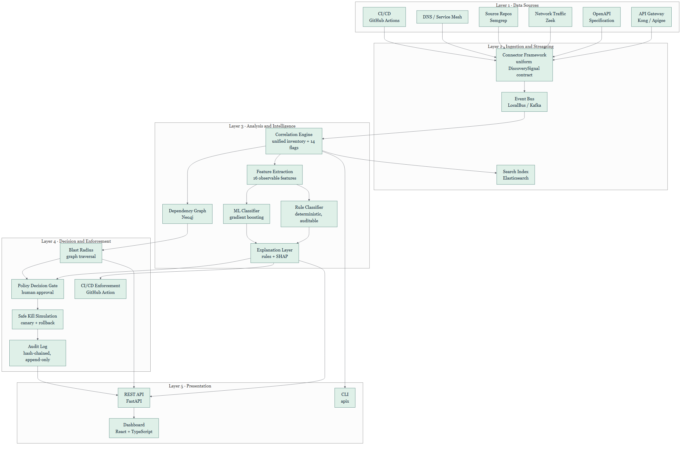

**Layer 1: Discovery.** Six connectors, each a partial and imperfect witness, each
emitting observations and never verdicts. Their common output type is the
`DiscoverySignal`, a record stating what one source observed about one endpoint. For
real projects, three of the six (code, specification, CI/CD) are read from the
repository, and usage is supplied by imported gateway access logs.

**Layer 2: Ingestion.** A message bus that decouples collection from analysis. The
default is an in-process `LocalBus` requiring no infrastructure; Kafka and
Elasticsearch backends implement the same interface for deployed operation.

**Layer 3: Analysis.** Correlation of signals into a unified inventory record per
endpoint, derivation of fourteen discrepancy flags, four-class classification by
weighted evidence rules, explanation, dependency-graph construction and blast-radius
computation, and the learned model with SHAP attribution.

**Layer 4: Decision and enforcement.** The removal gate, which requires the
classifier and the graph to agree independently; the Safe Kill controller, which
shadows, seeks approval, canaries and rolls back; retirement plans for real
projects; and the CI/CD enforcement action that stops new shadow and zombie
endpoints being merged.

**Layer 5: Presentation.** The command-line interface, the REST API, and the React
and TypeScript dashboard served by it, through which every part of the system is
operated from a browser.

The class model of the core domain is shown below. The significant structural point
is that `Verdict` composes a list of `Reason` objects with signed contributions and
is never a bare label: the same type serialises into the audit log and renders in
the explanation output and the dashboard.

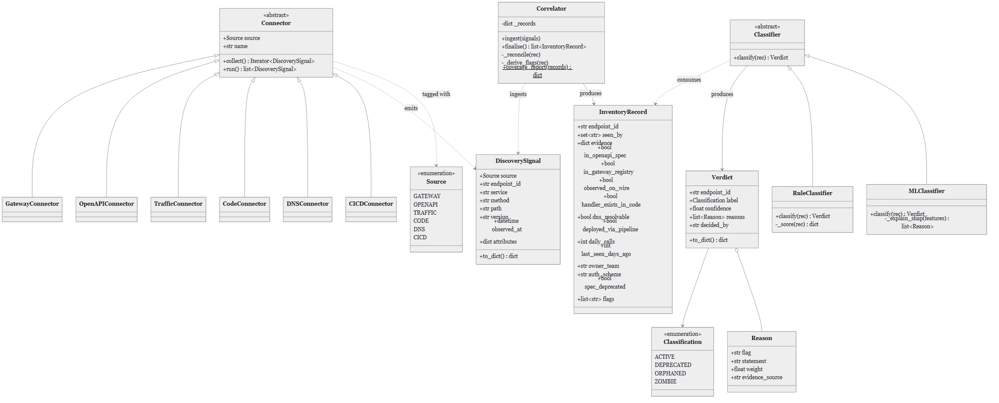

### 3.2 Hardware description and execution environment

This is a software project with no custom hardware, so this section describes the
execution environment that stands in the place of a hardware description. Every
component runs on commodity machines.

Table: Execution environment

| Item | Development and evaluation | Deployment |
|---|---|---|
| Machine | Windows 11 laptop, x86-64 | Any Linux host or Kubernetes node running containers |
| Runtime | Python 3.10 and 3.12; Node.js for building the dashboard only | Container image of 53 MB, Python runtime only |
| Optional services | None required | Neo4j (dependency graph), Kafka and Elasticsearch (transport) |
| External tools | git, Semgrep (for scanning real projects) | The same, where scans run |
| Network | Outbound HTTPS to GitHub, for scans of public repositories | Bound to localhost by default; TLS terminated by a proxy or ingress |
| Continuous integration | GitHub Actions on Linux, Python 3.10 and 3.12 | |

The default configuration deliberately requires no external infrastructure at all,
so that a reviewer can clone the repository and reproduce every number in Chapter 4
with a handful of commands, and the test suite needs nothing running.

Table: Technology stack and the justification for each choice

| Component | Technology | Why this and not the alternative |
|---|---|---|
| Route extraction | Semgrep (AST matching) | A route is a structural pattern: decorator, router mount, path parameter. Regex matching over source text is a heuristic that breaks on formatting and matches routes inside comments; AST matching does not. Justified by [3]. |
| Dependency store | Neo4j (Cypher), or in-process | Blast radius is a bounded multi-hop traversal over alternating call and ownership edges. A variable-length Cypher path expresses it directly where a relational recursive CTE does not. Precedent in [4]. |
| Traffic observation | Zeek (simulated), gateway access logs (real) | Passive full-visibility logging of what was actually called, rather than signature matching against known-bad patterns. The question is "what was used", not "what was an attack". |
| Streaming | Kafka | Traffic-derived signals are bursty and high-volume; the bus must buffer rather than block the collector. |
| Classification | Weighted evidence rules, with a gradient-boosted model as a veto | Rules work on day one with no training data and are auditable line by line, which is what allows a customer to be onboarded at all. The model adds precision where training data exists. |
| Explanation | SHAP `TreeExplainer` | Exact, additive, per-prediction attribution [8], affordable because this is a per-scan batch workload rather than the per-packet workload of [9]. |
| API | FastAPI over Uvicorn | Typed request models that reject unknown fields, so an approver's identity cannot be supplied in a request body; OpenAPI generated from the code. |
| Dashboard | React and TypeScript, built with Vite | React is the only runtime dependency, so there is little to audit; TypeScript strict mode catches the shape errors a security console cannot afford. |
| Repository access | `git clone --filter=blob:none` | A partial clone fetches history and file names without blob contents until needed, which is what the staleness analysis needs. Nothing from a scanned repository is ever executed. |
| Packaging and deployment | Python package with optional extras; Docker image | The core runs on the standard library alone; everything heavier is an extra, so each deployment installs only what it uses. |

### 3.3 Software description

`src/apix/` is organised as follows.

Table: Module responsibilities within src/apix/

| Module | Responsibility |
|---|---|
| `config.py` | Settings from environment, with defaults that need no infrastructure |
| `connectors/` | Six discovery sources, each with deliberate and documented blind spots |
| `ingestion/` | `LocalBus` (default), Kafka and Elasticsearch backends behind one interface |
| `inventory/` | Multi-source correlation into a unified inventory carrying 14 flags |
| `engine/` | Verdict types, the 15 evidence rules, explanations, the model and the hybrid veto |
| `graph/` | Dependency graph, blast radius, the removal gate; in-memory and Neo4j backends |
| `safekill/` | The state machine, the shadow-window policy, the controller, the audit log |
| `extractors/` | Semgrep AST route extraction for FastAPI, Flask, Express and Spring, and path normalisation |
| `live/` | Real repository scanning: clone, git history, CODEOWNERS, clients, dependencies, candidate evidence |
| `traffic/` | Access-log import (nginx, Apache, AWS ALB, Kong, API Gateway, Envoy, Traefik) and usage-based labels |
| `scanning/` | Background scan jobs, the report, retirement plans, exports, drift, data sensitivity |
| `enforce/` | CI enforcement: two snapshots of the API surface and the four rules applied to a change |
| `api/` | REST API, authentication and roles, metrics and logs, the built dashboard |
| `evaluation/` | Metrics, the comparative benchmark, model training, the Safe Kill evaluation |
| `dataset/` | The labelled dataset and its 16 observable features |
| `simulated_env/` | The synthetic estate, its generator, its simulated gateway, and the answer key |

**The six discovery sources and what each can and cannot see.** The choice of
exactly six is not arbitrary; each answers one question that no other source
answers, and the blind spots are the point.

Table: The six discovery sources and their systematic blind spots

| Source | Question it answers | Systematic blind spot |
|---|---|---|
| CODE | Does this endpoint exist in the source? | Cannot see whether anything calls it |
| DNS | Is it reachable on the network? | Says nothing about use or ownership |
| GATEWAY | Is it registered with the proxy? | Blind to services addressed directly |
| CICD | Was it deployed by a known pipeline? | Blind to manual and legacy deployments |
| TRAFFIC | Was it actually called? | Blind to anything silent during the window |
| OPENAPI | Is it documented? | Blind to whatever the team forgot to document |

A zombie is the pattern where these answers **disagree**: the code defines it, DNS
resolves it, and the gateway, the specification, the pipeline and the traffic
capture have all never heard of it.

The correlation step turns signals into an inventory record and derives fourteen
discrepancy flags: `UNDOCUMENTED`, `UNREGISTERED`, `SHADOW_CANDIDATE`,
`NO_TRAFFIC_IN_WINDOW`, `EFFECTIVELY_SILENT`, `STALE_6M`, `NO_OWNER`,
`REACHABLE_BUT_UNUSED`, `UNAUTHENTICATED`, `LEGACY_AUTH`, `SENSITIVE_DATA`,
`MARKED_DEPRECATED`, `CODE_UNTOUCHED_1Y` and `NO_PIPELINE_RECORD`. The dataset layer
derives sixteen observable features from the same record for the learned model; both
are listed in Appendix B.

The sequence of a full scan is shown below.

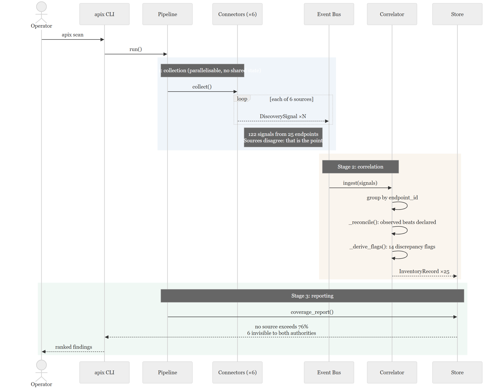

An endpoint's lifecycle, and the transitions the classifier is detecting, are shown
as a state machine.

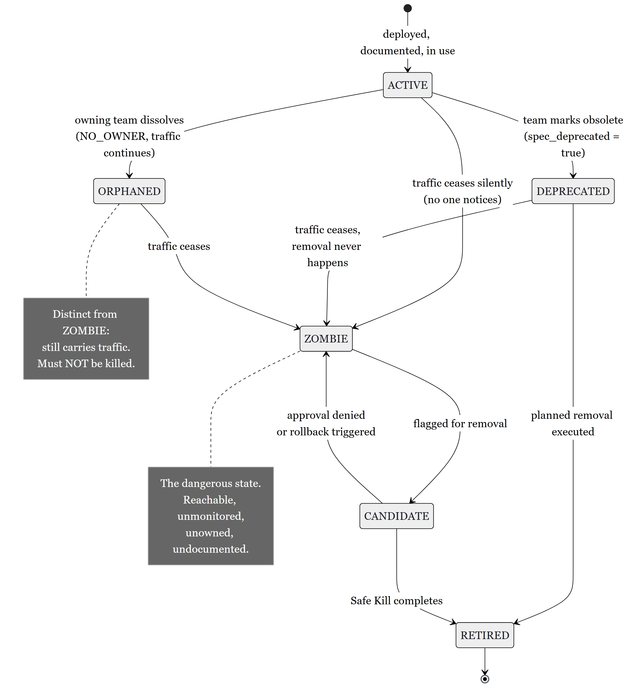

### 3.4 Algorithms

#### 3.4.1 Multi-source correlation

```
DEFINE correlate(signals):
  GROUP signals BY (method, path) normalised across frameworks
  FOR each endpoint group:
    CREATE inventory record
    RECORD which sources observed it        -- presence
    RECORD which sources were consulted     -- so absence can be distinguished
                                            -- from "never asked"
    MERGE attributes, preferring OBSERVED over DECLARED
        (traffic-observed auth outranks gateway-declared auth, because a gateway
         can claim OAuth2 on a route the service also exposes directly with none)
    DERIVE the 14 discrepancy flags from the merged record
  RETURN inventory
```

The `sources_consulted` set is the mechanism that makes the whole system honest. It
is what distinguishes *"traffic saw nothing"* from *"traffic was never collected"*,
and every downstream claim depends on that distinction. Path normalisation matters
as much as it sounds trivial: `/users/{id}`, `/users/:id` and `/users/<int:id>` are
one endpoint written in three frameworks' conventions, and treating them as three
would report shadow APIs that do not exist.

#### 3.4.2 Evidence scoring with abstention

Classification is additive rather than a decision tree. Each of fifteen rules holds
a predicate over the inventory record, a set of source requirements, and a signed
weight per class. The complete rule table, with every weight, is Appendix B.

```
DEFINE classify(record, sources_consulted):
  scores <- {ACTIVE: 0, DEPRECATED: 0, ORPHANED: 0, ZOMBIE: 0}
  reasons <- []

  FOR each rule in RULES:                      -- 15 rules
    IF NOT rule.evaluable_with(sources_consulted):
      CONTINUE                                 -- abstain: the source was never asked
    IF rule.predicate(record):
      FOR each class, weight in rule.weights:
        scores[class] <- scores[class] + weight
      APPEND Reason(rule.statement, contribution) to reasons

  IF no rule was evaluable:
    RETURN Verdict(INDETERMINATE, confidence = 0.25, reasons = [])
  label      <- argmax(scores)
  confidence <- softmax(scores, temperature = 3.0)[label]
  RETURN Verdict(label, confidence, reasons, sources_consulted)
```

Two properties follow from the additive form and neither is available from a
decision tree. It **degrades gracefully**: an abstaining rule removes its
contribution instead of breaking a branch. And confidence is derived from the
**margin** between the top classes, so an endpoint whose evidence genuinely does not
distinguish two classes reports low confidence rather than an arbitrary choice. The
weights were set from the class definitions before accuracy was measured and were
deliberately never tuned against the answer key.

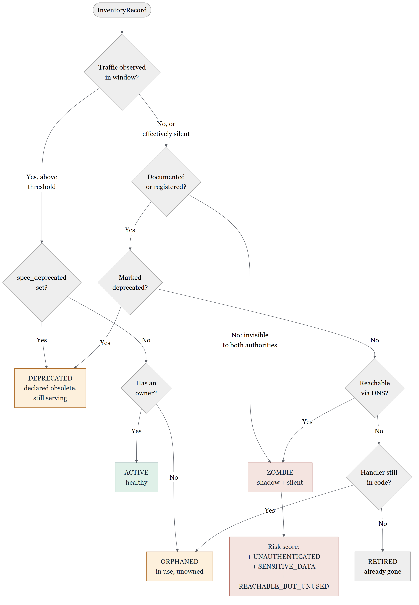

**Abstention has a measurable effect, and it is the project's answer to the question
of what happens when sources are missing.** A rule declares the sources it needs;
when those were never consulted it contributes nothing.

Table: Rule availability and the claims permitted under each source set

| Sources available | Rules usable | What the system can claim |
|---|---|---|
| All six | 15 / 15 | Full lifecycle classification |
| Repository only (CODE, OPENAPI, CICD) | 6 / 15 | Endpoints exist; **no lifecycle claim** |
| Traffic only | 5 / 15 | Usage, but not documentation or ownership |
| Code only | 3 / 15 | Existence only |
| Gateway only | 0 / 15 | Can list endpoints; **classifies nothing** |

The gateway-only row is the important one. With no evaluable rules the system reports
every endpoint as *indeterminate* rather than defaulting them to healthy: it has not
classified anything, it has failed to, and it says so.

**What would change a verdict: counterfactual explanations.** The signed reasons say
why an endpoint received its label; an operator also needs the other half, what would
have to be different for the label to change. For each verdict the system computes
this rather than writing it. A copy of the endpoint's record is altered in one
observable way (it carries ten or more calls a day, it falls silent, an owning team is
recorded or lost, it is documented and registered, the specification marks it
deprecated, another service is seen calling it, a pipeline deploys it, its handler is
changed recently) and classified again by the same classifier with the same sources
consulted. The changes that move the label are reported, with the label and
confidence they would give; pairs of changes are tried only when no single change is
enough. Because the rules that need an unconsulted source still abstain, a
counterfactual can never rest on evidence the scan could not see, and a test asserts
that every reported counterfactual, re-applied, produces exactly the label it claims.
For the zombie `GET /v1/kyc/documents/{id}/raw` the answer is a single change: it
would be ORPHANED, not ZOMBIE, if it carried ten or more calls a day.

#### 3.4.3 The removal gate

```
DEFINE assess_removal(verdict, graph, endpoint):
  IF verdict.label is not ZOMBIE:              RETURN blocked("not a zombie")
  IF NOT verdict.is_determinate:               RETURN blocked("insufficient evidence")
  IF verdict.vetoed_by_model:                  RETURN blocked("model objection")
  IF TRAFFIC not in verdict.sources_consulted: RETURN blocked("no usage evidence")

  radius <- graph.blast_radius(endpoint)       -- BFS over alternating CALLS/OWNS edges
  IF NOT radius.is_isolated:                   RETURN blocked("has dependants")

  RETURN may_proceed(radius)
```

Two independent systems must agree. The evidence classifier must call it a zombie
and the dependency graph must find nothing depending on it. Blast radius alternates
`CALLS` and `OWNS` edges, because removing an endpoint breaks its callers, whose own
endpoints then degrade, and whatever called *those* is affected in turn; in Cypher
the traversal is a single variable-length pattern, `(dep)-[:CALLS|OWNS*1..N]->(e)`.

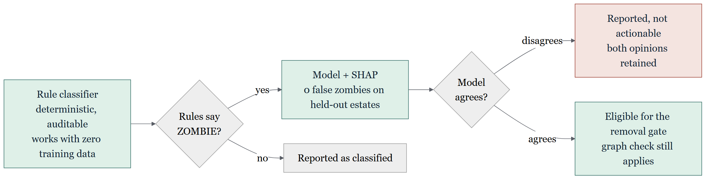

The learned model participates only through `vetoed_by_model`. It may block a
removal the rules proposed; it can never create one. Both opinions are retained on
the verdict, so an auditor sees that the rules proposed removal and the model
objected.

#### 3.4.4 Safe Kill: shadow, approval, canary and rollback

The removal gate ends with a candidate that two independent systems agree is dead.
That agreement is still not proof: a caller that was silent while traffic was
captured is invisible to both. Safe Kill is what happens next, and its state machine
is the design document's diagram made executable: a transition the design does not
contain raises an error instead of being recorded.

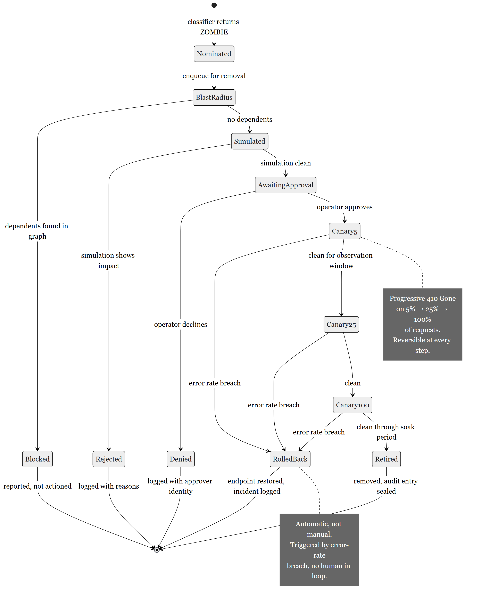

**Why a shadow comes before the canary.** The design originally drew a 5% → 25% →
100% canary. Measurement (Section 4.6) showed that the endpoints which reach this
stage carry one to nine calls a day, and a 5% canary on a one-call-a-day endpoint
refuses an expected 0.05 requests a day: it almost always sees nothing. The first
stage was therefore built as a **shadow kill**, in which nothing is refused and every
request that *would* have been refused is recorded with its caller. It harms nobody,
so it can run as long as the statistics require.

**How long.** Requests to a rarely used endpoint arrive approximately as a Poisson
process. A caller making `r` requests a day is missed by a window of `W` days with
probability `exp(-r W)`, so to be confident `c` of seeing it at least once:

```
W >= ln(1 / (1 - c)) / r
```

At `c` = 0.95, ln(20) ≈ 3.0, the *rule of three*. The default slowest caller is one
call every thirty days, the month-end batch job that is the textbook hidden
dependency, which gives a window of **90 days**. The parameter is exposed, and a
quarterly caller needs a longer window; the guarantee is exactly as strong as it.

```
DEFINE safe_kill(candidate, policy, backend, approver, audit):
  RECORD NOMINATED; RECORD BLAST_RADIUS
  IF NOT gate_clears(candidate):        RECORD BLOCKED; STOP
  window <- backend.observe(candidate, days = policy.shadow_days, shadow = TRUE)
  IF window.identified_callers:         RECORD REJECTED(names); STOP
  baseline <- window.anonymous_rate     -- scanners, health checks
  RECORD AWAITING_APPROVAL
  decision <- approver.decide(candidate, evidence = window)
  IF decision is DECLINE:               RECORD DENIED; STOP
  FOR stage, days IN [(5%, 7), (25%, 7), (100%, 14)]:
    RECORD CANARY(stage)
    w <- backend.observe(candidate, days, refuse_fraction = stage)
    IF w.identified_refusals > 0
       OR w.anonymous_refusals > expected(baseline) + 3 * sqrt(expected) + 1:
      backend.restore(candidate); RECORD ROLLED_BACK(reason); STOP
  backend.retire(candidate); RECORD RETIRED
  -- every RECORD appends to the hash-chained audit log
```

A breach is any refused request from an *identified* caller, since one named
principal that needed the endpoint is enough, or anonymous refusals more than three
standard deviations above what the shadow's baseline predicts. An unauthenticated
endpoint carrying anonymous traffic can never be removed, by automation or by a
person, because a forgotten partner integration and an attacker's scanner are
indistinguishable on the wire; the approval is refused, and the recommendation that
resolves it is to put authentication in front of it and shadow it again.

**The audit log.** Each entry carries the SHA-256 of its canonical content and of
the entry before it, so editing, deleting or reordering any entry breaks every hash
after it. Appends from concurrent processes take an exclusive lock, re-read the head
under it, and write and flush to disk before releasing. The chain makes tampering
*detectable*, not impossible: anyone able to rewrite the whole file can recompute
the whole chain, which is why the deployment guidance is to anchor the latest hash
in a store the operator cannot write.

The controller is barred from importing the simulated world by the same AST guard
that protects the classifier, and learns about traffic only through an
`EnforcementBackend` protocol that a real gateway plugin would implement
identically.

#### 3.4.5 Zombie candidates on real code

A repository holds no traffic, so it cannot prove an endpoint dead. It does hold
evidence that one is, and a scan of real code ranks **candidates** from it. Each
signal below adds to or subtracts from a score; a score of 2 makes a candidate, and
"likely zombie" needs 4 together with a newer version, a deprecation, or no client
use of an endpoint frozen for a year.

Table: Evidence signals for zombie candidates on real code

| Signal | Weight |
|---|---|
| A newer version of the same operation exists | +3 |
| ...and the project's own client calls only the newer one | +2 |
| Marked deprecated in the specification or the code | +3 |
| The project's own clients use its neighbours but not it | +2 |
| A debug or test endpoint shipped in the API | +2 |
| Undocumented while the specification documents its neighbours | +2 |
| An internal endpoint that a public gateway route also matches | +1 |
| Unchanged for a year while the rest of the project changes | +1 |
| Referenced by a client, or called by another service | −2 |

Health probes, metrics, token-key and documentation endpoints are never candidates,
and neither are administrative endpoints merely because a front end does not call
them. Client coverage below 30% never counts as evidence of non-use, because a
gateway that rewrites paths can hide a front end's calls. Every candidate is
labelled *suspected*, with the sentences behind its score, and with what would change
its standing, found by rescoring without each kind of evidence: crAPI's
`v2.7/user/login-with-token` would fall from a likely zombie to a superseded version
if the project's own client called it.

#### 3.4.6 Usage from gateway access logs

To prove a candidate, a security team imports its gateway's or load balancer's
access logs. Each request is matched to the endpoint whose route template it fits,
most literal first (`/users/me` before `/users/{id}`), and a gateway prefix the code
never sees is found and reported. Three guards keep silence from being over-read,
because a false ZOMBIE is an outage: absence counts only for a service the logs
demonstrably cover, the window must be at least seven days, and failed requests are
not use.

```
DEFINE label_from_logs(endpoint, usage, window_days, service_covered):
  -- usage.ok counts successful requests only; requests answered only with
  -- 401, 403 or 404 are probing, which is attack surface, not a customer
  IF usage.ok > 0:
    IF endpoint is marked deprecated:  RETURN DEPRECATED  -- migrate callers first
    IF endpoint has no owning team:    RETURN ORPHANED    -- assign one, never remove
    RETURN ACTIVE
  IF endpoint is a probe or documentation route:
    RETURN INDETERMINATE("monitor traffic is often not in access logs")
  IF NOT service_covered:            -- no request to ANY endpoint of its service
    RETURN INDETERMINATE("these logs do not cover this service")
  IF window_days is unknown OR window_days < 7:
    RETURN INDETERMINATE("window unknown or too short")
  bound <- window_days / 3           -- rule of three at 95% confidence
  RETURN ZOMBIE("no successful request in window_days; called less than once
                 every bound days", noting any failed probing requests)
```

Logs are the most sensitive file anyone will hand this tool, so query strings are
dropped as each line is read and client addresses become salted hashes used only to
count distinct clients; the salt is random per import and never stored.

#### 3.4.7 CI/CD enforcement

Detection and Safe Kill deal with zombies that already exist; enforcement stops new
ones being made. On a pull request it takes two snapshots of the API surface, at the
merge base and at the head, and applies four rules **only to what the change
touches**:

Table: The four enforcement rules

| Rule | Fails when the change | Default |
|---|---|---|
| Undocumented endpoint | adds a route with no OpenAPI entry: a shadow API from its first commit | error |
| Unowned endpoint | adds a route no CODEOWNERS entry and no `x-owner` covers | error |
| Zombie in the making | removes an endpoint from the specification but leaves its handler | error |
| Documented, not implemented | adds a specification entry with no handler behind it | warning |

The third rule is specific to this project: every zombie in the simulated estate was
made by removing a route from the specification and never deleting its handler.
Existing debt is never held against a change, the policy file is read from the merge
base so a change cannot exempt itself, and every exemption must carry a reason.

### 3.5 How a repository scan works

A scan of a real project is the path most users take first, so this section
follows one from input to report. The figure gives the stages; the table says what
each does and how each guards against being wrong.

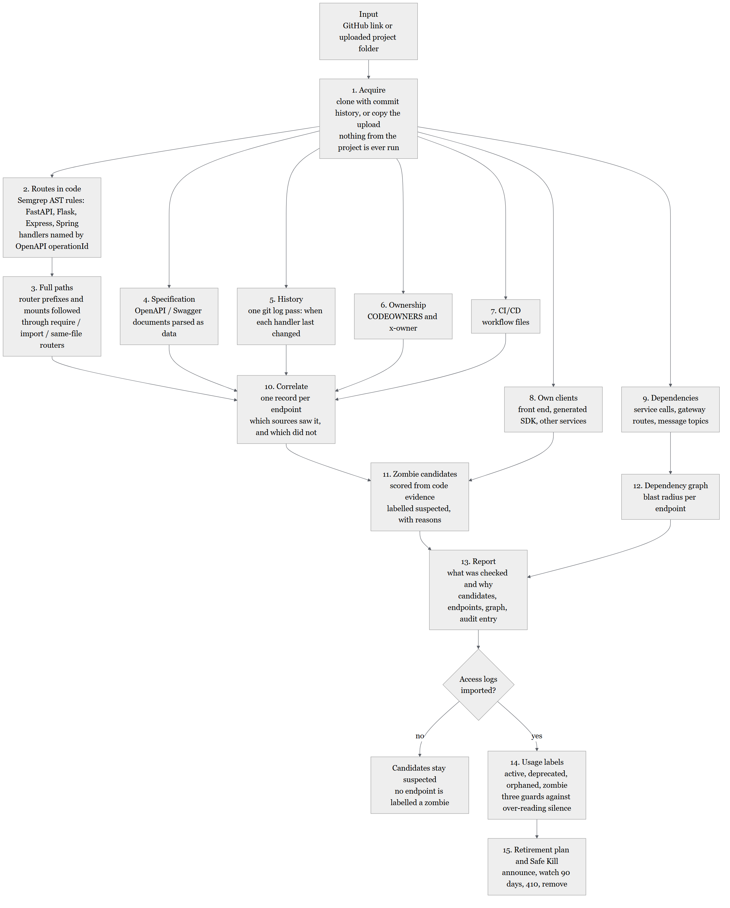

Table: The stages of a repository scan

| Stage | What it does | How it avoids being wrong |
|---|---|---|
| 1. Acquire | A GitHub link is cloned with its commit history (`git clone --filter=blob:none`, long paths enabled); an uploaded folder is copied after the browser has left out dependency and build folders, images and files over 2 MB | Nothing from the project is ever executed; an uploaded file name that could point outside the upload is refused |
| 2. Routes in code | Semgrep matches route declarations in the syntax tree: FastAPI and Flask decorators, Express `app.get(...)` and chained `router.route(...).get(...)`, Spring mapping annotations. Handlers wired only by an OpenAPI `operationId` (Connexion, API-first Spring) are found by name | Structural matching: a route written in a comment or a string is not counted. Dependency, build and test folders, end-to-end suites and `*.spec.*` / `*.test.*` files are excluded, because a route there is not served |
| 3. Full paths | Each route is given the prefix it is actually served under: FastAPI router and mount prefixes, a prefix held in a settings constant where the project spells it out, Express routers followed through `require`/`import` and through routers built in the same file, Spring class-level prefixes. Path parameters are normalised (`:id`, `<int:id>` and `{id}` are one parameter) | Where a prefix cannot be known, the route is marked *prefix unresolved* rather than shown with a guessed path |
| 4. Specification | Every OpenAPI or Swagger document, `docs/` included, is parsed as data | Read, never executed; tags are not taken as owners |
| 5. History | One `git log` pass gives the date each handler file last changed | An uploaded folder has no history, so staleness is reported as unknown, never as zero |
| 6. Ownership | `CODEOWNERS` and `x-owner` in the specification | With neither, no endpoint has a known owner, and the report says so |
| 7. CI/CD | Workflow files that build and deploy the project | |
| 8. Own clients | Calls the project's own front end, generated SDK and other services make (`fetch`, `axios`, generated client methods) | Client coverage below 30% never counts as evidence of non-use |
| 9. Dependencies | HTTP calls between services (RestTemplate, WebClient, Feign, `fetch`, `axios`, `requests`, `httpx`), gateway routes and message topics | Test code is left out: a call in a test is not a production dependency |
| 10. Correlate | One record per endpoint, recording which sources saw it and which did not | Absence is recorded only for sources that were consulted |
| 11. Candidates | Scored from the evidence signals of Section 3.4.5 | Every candidate is labelled *suspected*, with the sentences behind its score |
| 12. Graph | Blast radius for every endpoint from the code's call graph | The page states that callers outside the repository cannot appear |
| 13. Report | Counts, candidates, endpoints, the graph, and **what was checked**: every stage marked worked, partly, not available or failed, with its reason. The report's SHA-256 fingerprint is the first entry of the scan's audit chain | A stage that could not run says why, instead of silently contributing nothing |
| 14–15. Usage and removal | Imported access logs turn suspicion into usage-based labels (Section 3.4.6); a proven zombie gets a retirement plan | Without logs, nothing is labelled a zombie |

**A scan in numbers: OWASP crAPI.** crAPI is four services written in Java, Python,
Go and Django. One scan found 62 endpoints: 40 from route declarations in the Spring
identity service and the Python chatbot, and 22 only through the specification,
because Django and Go routes are not yet extracted from code. It read 283 commits
for staleness and 3 workflow files, found 46 endpoints referenced by the project's
own client code across 261 files, and 60 calls between services, and ranked 6
candidates. The Overview of that scan is shown in Section 3.7.

### 3.6 Using the application: classification and Safe Kill

This section shows how the two central decisions are reached and how a user sees
and acts on them. It uses the demo bank, where all six evidence sources exist, so
that the full classification and a complete removal can be shown.

#### 3.6.1 How an endpoint is classified, worked through

Every rule whose sources were consulted and whose condition holds adds its signed
weights to all four classes; the class with the highest total wins. Confidence is
the softmax of the four totals at temperature 3:

```
confidence(label) = exp(score[label] / 3) / Σ over the four classes of exp(score[c] / 3)
```

**A zombie.** `GET /v1/kyc/documents/{id}/raw` serves raw identity documents. Eight
of the fifteen rules fire:

Table: Classifying GET /v1/kyc/documents/{id}/raw: every rule that fired

| Rule that fired | Evidence | ACTIVE | DEPRECATED | ORPHANED | ZOMBIE |
|---|---|---:|---:|---:|---:|
| No meaningful traffic in the window | TRAFFIC | −3.0 | +0.5 | −2.5 | +3.5 |
| Absent from both specification and gateway | OPENAPI, GATEWAY | −2.0 | −1.5 | | +2.5 |
| No meaningful use for over six months | TRAFFIC | −2.0 | | −1.5 | +2.0 |
| Resolvable via DNS despite no traffic | DNS, TRAFFIC | | | | +1.5 |
| No CI/CD pipeline record | CICD | −0.8 | | | +1.2 |
| Handler in code but undocumented | CODE, OPENAPI | −1.0 | −1.0 | | +1.0 |
| No commit to the handler in over a year | CODE | −0.8 | +0.5 | | +1.0 |
| No owning team | OPENAPI, CICD, CODE | −2.0 | | | +0.8 |
| **Total** | | **−11.6** | **−1.5** | **−4.0** | **+13.5** |

ZOMBIE wins with +13.5, and its confidence is exp(13.5/3) divided by the sum of the
four exponentials, **0.990**. The total is not a black box: it is the sum of the
rows above, and the dashboard shows exactly these rows as the explanation.

**An orphaned endpoint, and why it is not a zombie.** `GET /v1/cards/rewards/catalogue`
has no owning team either, but it is in use:

Table: Classifying GET /v1/cards/rewards/catalogue: every rule that fired

| Rule that fired | ACTIVE | DEPRECATED | ORPHANED | ZOMBIE |
|---|---:|---:|---:|---:|
| Carrying real traffic with no owner | | | +3.5 | −1.0 |
| Serving real traffic above the threshold | +2.0 | +1.0 | +1.5 | −3.5 |
| Used within the last 30 days | +1.5 | | +1.0 | −2.0 |
| Other services observed calling it | +1.2 | | +1.0 | −1.5 |
| In both specification and gateway | +1.5 | | | −1.5 |
| No owning team | −2.0 | | | +0.8 |
| **Total** | **+4.2** | **+1.0** | **+7.0** | **−8.7** |

ORPHANED wins at 0.652 confidence, and ZOMBIE is the lowest of the four: usage
evidence counts heavily against removal. (The last two rules carry no weight for
ORPHANED, so the application's explanation, which lists what bears on the winning
class, does not show them; the totals include them.) This is the distinction Chapter 1 called
the most important one, and here it is in the arithmetic: two unowned endpoints,
one used and one not, end up on opposite sides.

**When the evidence cannot decide.** `POST /v1/kyc/aadhaar/ekyc` is truly
deprecated, but its team never set the deprecation flag, so the deprecation rule
cannot fire. The five rules that do fire are exactly those that fire for a healthy
endpoint, giving ACTIVE at 0.803, the same confidence as a correct ACTIVE. Section
4.2 discusses why this is reported rather than tuned away.

**In the application.** On the demo bank's **Endpoints** tab, selecting an endpoint
opens its **Why** panel: the label, the confidence and whether the rules or the model
decided; each fired rule as a signed bar with the source that witnessed it; the six
sources as tiles, those consulted that did not see the endpoint marked *absent*; what
would change the verdict; its discrepancy flags; and its blast radius. Opening **How the score was worked out** shows the same
arithmetic as the tables above: every rule that fired with its weight for all four
classes, the totals with the winning class highlighted, the confidence computed from
them, and any rule that could not be evaluated because its source was never
consulted. The application computes this table from the verdict itself, and a test
asserts that its columns sum exactly to the engine's scores.

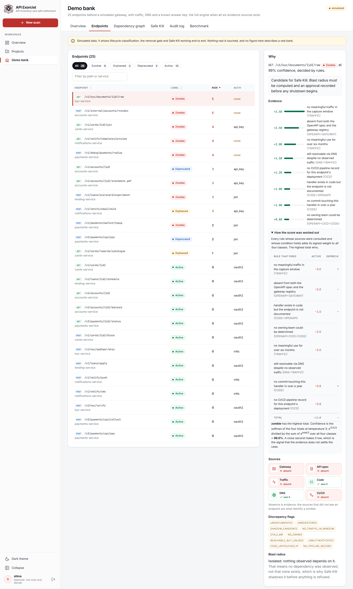

For a real project, the same labels come from the **Usage** tab once access logs are
imported, each with its reason: for example, "no successful request in 45 days. At
95% confidence it is called less than once every 15 days."

#### 3.6.2 How a removal is carried through Safe Kill

The **Safe Kill** tab opens with the five steps of a removal laid out side by side:
what each step does, what can stop a removal there, and how many candidates are at
each step now.

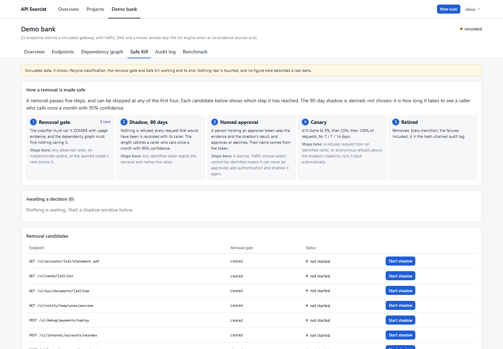

A removal is driven from that tab in five steps:

1. **Candidates.** The tab lists every endpoint the removal gate cleared: classified
   ZOMBIE, with usage evidence, and isolated in the dependency graph. On the demo
   bank that is all eight zombies.
2. **Start shadow.** For the chosen candidate the controller runs the shadow window,
   ninety days in which nothing is refused and every request that would have been is
   recorded with its caller (simulated instantly on the demo bank). An identified
   caller ends the walk with the removal rejected and the caller named.
3. **Decide.** A clean shadow puts the candidate under **Awaiting a decision**, with
   its classification reasons and the shadow's result. An approver approves or
   declines, optionally with a note; the decision is recorded under the name bound to
   their token, never a name typed into the form.
4. **Canary.** Approval starts the canary: `410 Gone` to 5%, then 25%, then 100% of
   requests for 7, 7 and 14 days, rolled back automatically on any breach.
5. **Record.** The **Decided** list shows each candidate's full path through the
   states, and every transition is in the **Audit log** tab, hash-chained and
   verifiable in one click.

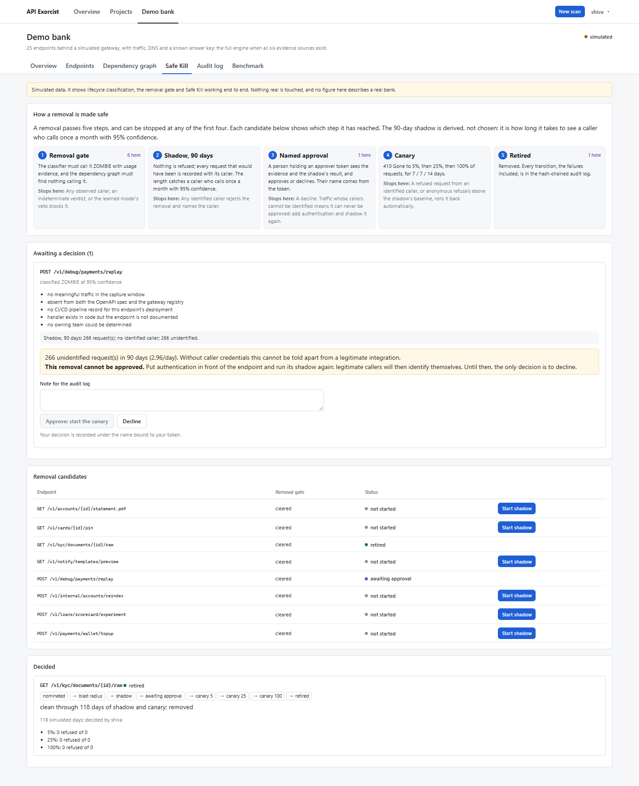

The figure shows a run on the demo bank. `GET /v1/kyc/documents/{id}/raw` was
approved and went through nominated, blast radius, shadow, awaiting approval, the
three canary stages and retired, clean after 118 simulated days (90 days of shadow
and 28 of canary) with no request refused. `POST /v1/debug/payments/replay` is shown
waiting: its shadow recorded 266 requests in 90 days (2.96 a day), none from an
identifiable caller. Because such traffic cannot be told apart from a legitimate
integration, **it can never be approved**: the Approve button is disabled with the
advice beside it, the server refuses an approval sent any other way, and the only
decision left is to decline.

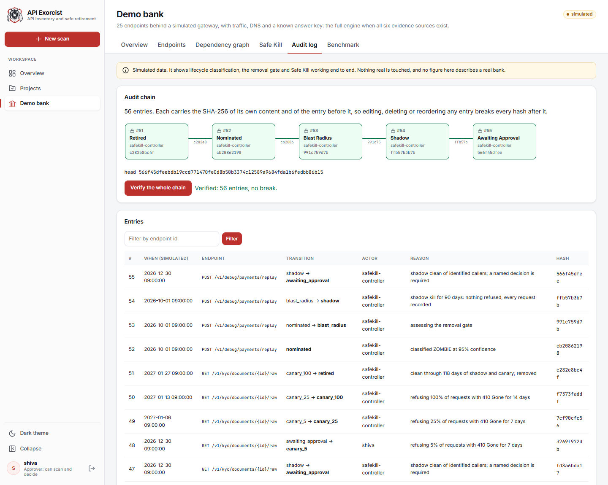

The audit log of the same run holds 16 entries. Each records the transition, its
actor and its reason, and carries a hash that covers the entry before it. Fifteen
were made by the controller; the one approval is credited to the person who held the
approver token.

### 3.7 Implementation: the application and its deployment

Every part of the system is operated from a browser. `apix serve` starts the API
and opens the dashboard, signed in, on the local machine; a deployment runs the same
server in the container image. A scan is started by uploading a project folder or
pasting a GitHub link; it runs in the background and its page shows each stage as it
happens. The figures below are screenshots of the implemented application, scanning
the public OWASP crAPI project.

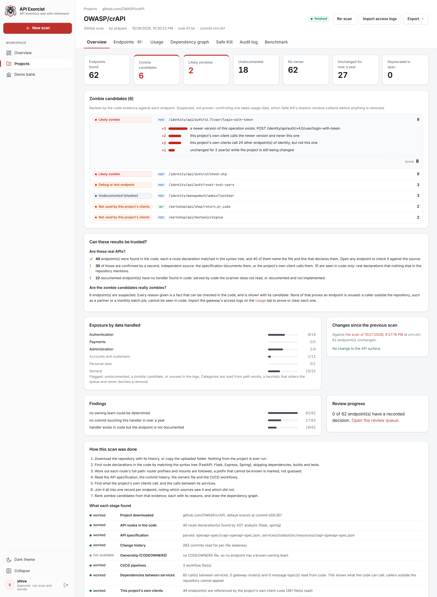

The Overview opens with the zombie candidates. Below them, **Can these results be
trusted?** states what the results rest on: how many endpoints were found in code
and traced to their declaring line (40 for crAPI), how many a second independent
source confirms (30), how many documented endpoints have no handler in code (22,
crAPI's Django and Go services), and why none of the candidates is proof of disuse.
**How this scan was done** lists the stages of Section 3.5 in order, followed by
what each stage found: worked, partly, not available or failed, each with its
reason. A scan of real code never labels an endpoint a zombie, and the page says
why.

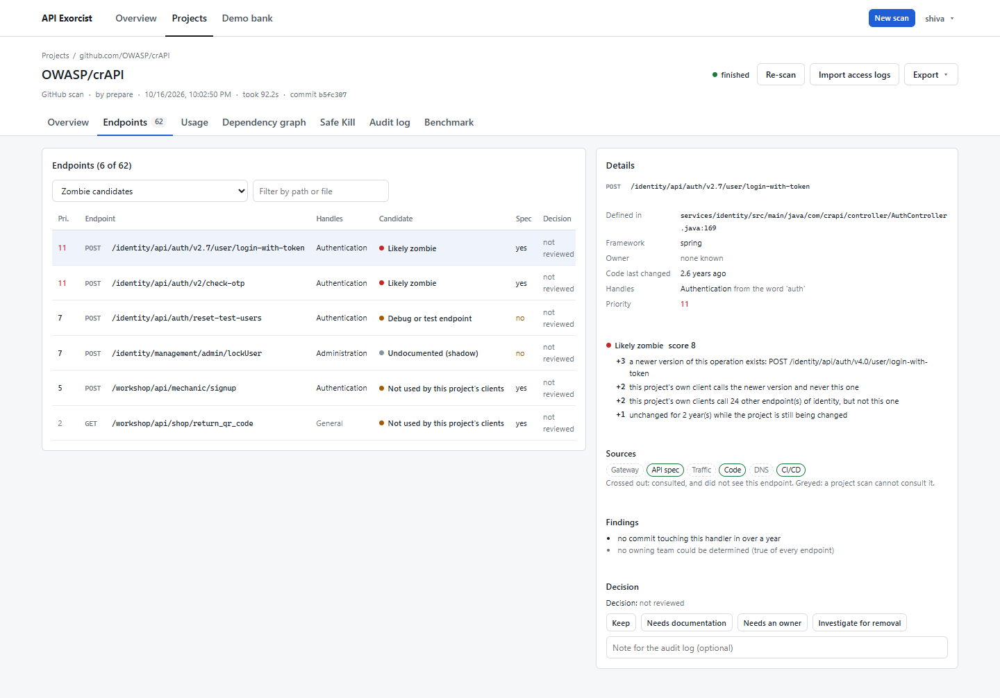

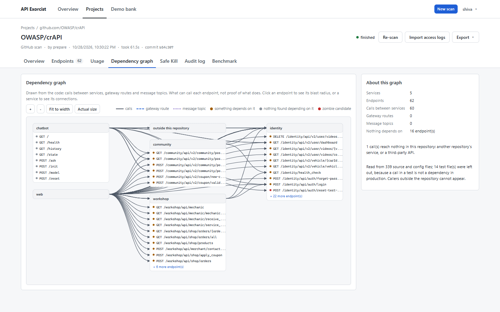

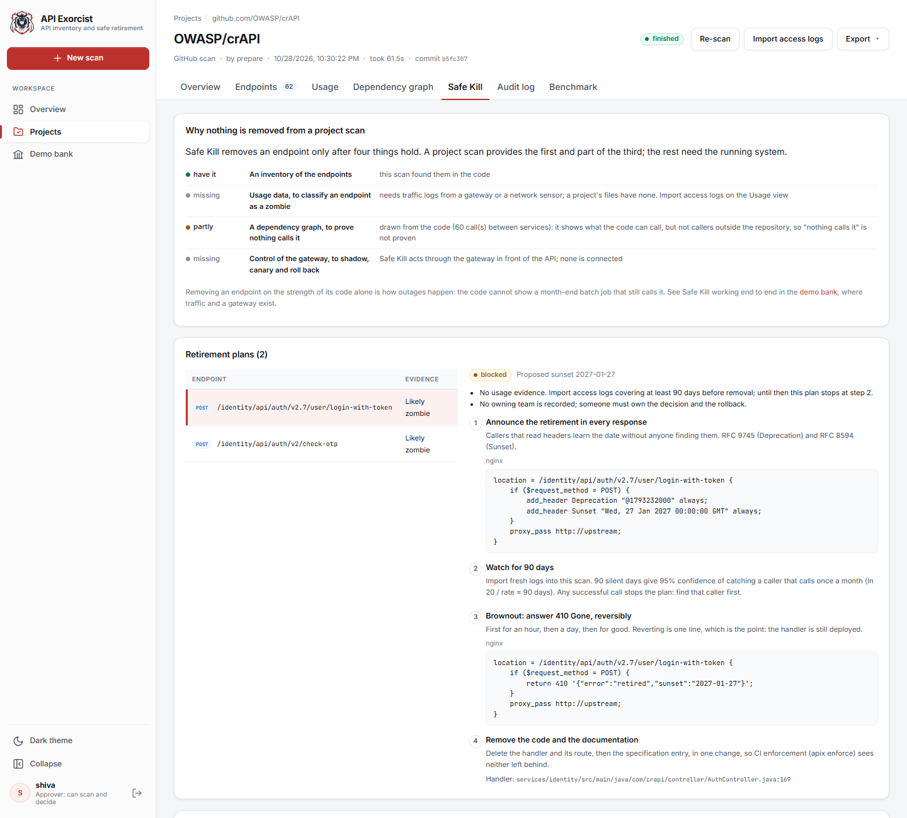

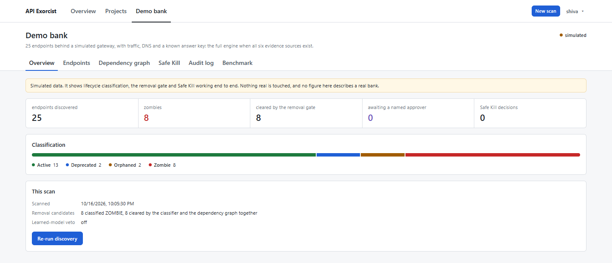

**The REST API.** Every route except `/v1/health` requires a bearer token, reads
included, because the inventory is a map of an estate's weakest points. Tokens are
256-bit random values stored only as SHA-256 hashes, with two roles: *viewer* and
*approver*. An approver's name is taken from their token, never from the request,
and request bodies reject unknown fields, so there is no field through which an
identity could be forged in the audit log. The server binds to localhost and refuses
any other address unless told otherwise, because bearer tokens over plain HTTP travel
in cleartext. The full route list is in Appendix B.

**The dashboard** is served from the same origin as the API under a strict
Content-Security-Policy with no inline script. The token is held in session storage,
sent only in the `Authorization` header, never in a URL; the one-time token minted by
`apix serve` reaches the browser in the URL *fragment*, which browsers never send to
a server, and is erased from the address bar at once. The production build is
committed into the Python package, so installing the package gives a working
dashboard on a machine with no Node.js, and CI fails if the committed build differs
from the source.

**The interface.** The console is built to the standard of commercial security
tools, and every element carries information rather than decoration. A sidebar
holds where one can go and the page holds what one is doing. One severity scale
(critical, high, medium, low, ok, info), in light and dark themes, colours every
status, priority and chart, so the same colour means the same thing on every page.
The Overview shows how each figure moved since the previous scan, the estate as a
ring split by the worst thing known about each endpoint, and exposure by what
endpoints handle. Lists filter by chips with counts and sort by any column; an
endpoint's details open in an inspector beside the list, with its evidence drawn as
signed bars and the six sources as tiles marked *saw it*, *absent* or *not asked*,
so that absence reads as the evidence it is (Section 3.6). A
Safe Kill removal is drawn as a five-stage pipeline and the audit log as a chain of
linked blocks that lights up when verified. Charts are plain SVG and the fonts are
bundled with the build, because the Content-Security-Policy admits nothing from
another origin; motion is switched off for anyone whose system asks for reduced
motion. Every page was measured at five window widths to fit without horizontal
scrolling.

**Outputs for other tools.** A scan exports SARIF 2.1.0 [21] for code-scanning
dashboards, an inventory CSV for a spreadsheet or GRC tool, an OpenAPI 3.1 [20]
skeleton of every undocumented endpoint, and a printable executive report.
**Retirement plans** write out the gateway configuration for each removable
endpoint: announce with `Deprecation` and `Sunset` headers [18] [19], watch ninety
days of fresh logs, answer `410 Gone` [17] reversibly, then delete the handler and its
specification entry together.

**Deployment and operations.** The container image runs as an unprivileged user on
a read-only root filesystem, from a base image pinned by digest, with no compiler,
source tree or pip in the runtime layer, and refuses to start without configured
tokens. It exposes Prometheus metrics labelled by route template rather than raw
path, so a client cannot create unbounded time series, and writes one JSON log line
per request carrying a request id and the principal's name but never a token or a
request body.

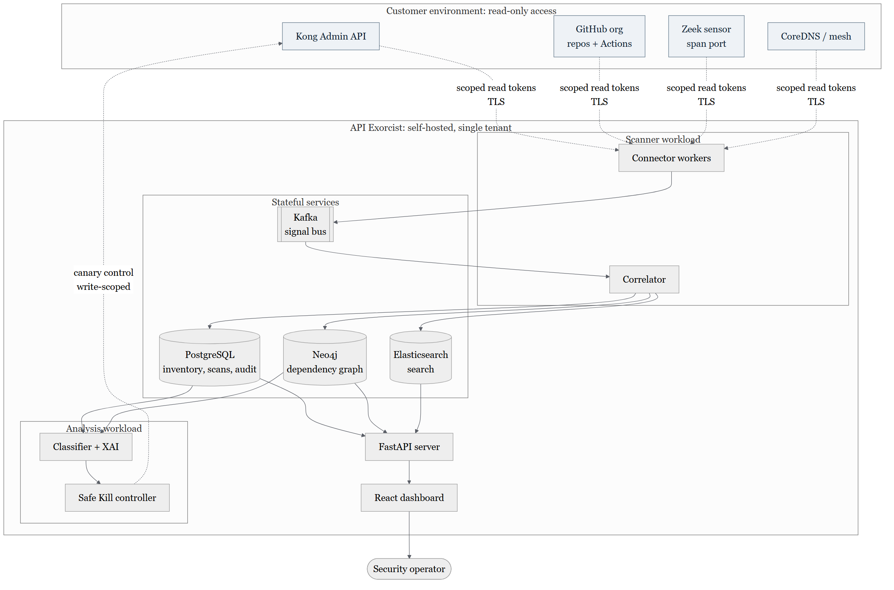

### 3.8 Standards and specifications followed

The guidelines ask that the standards followed be stated where they apply. The
project follows the following standards and specifications; none is claimed as a
certification.

Table: Standards and specifications followed, and where

| Standard or specification | Used for | Where in the system |
|---|---|---|
| IEEE Std 1016-2009, Software Design Descriptions [16] | Organising the design document by design viewpoint: composition (component diagram), logical (class diagram), interaction (sequence diagram), state dynamics (two state machines), algorithm (decision logic) and deployment | `docs/design-document.md` |
| ISO/IEC/IEEE 29119-1, Software testing [22] | Describing the test strategy by test level: unit, integration, system and acceptance (Section 4.1) | `tests/` |
| IEEE Std 1012-2016, Verification and Validation [23] | Separating verification (does the code do what the design says: tests, types, the claims verifier) from validation (does it solve the problem: the benchmark, the Safe Kill evaluation, real repositories) | Chapter 4 |
| RFC 9110, HTTP Semantics [17] | `410 Gone` as the reversible retirement response; status-code meaning in log analysis | `scanning/retire.py`, `traffic/usage.py` |
| RFC 9745, Deprecation header [18], and RFC 8594, Sunset header [19] | Announcing a retirement to clients before it happens | `scanning/retire.py` |
| OpenAPI Specification 3.x [20] | Reading committed specifications; exporting skeletons for undocumented endpoints | `live/connectors.py`, `scanning/exports.py` |
| SARIF 2.1.0 [21] | Exporting findings to code-scanning tools | `scanning/exports.py` |
| RFC 5737, IPv4 documentation addresses [24] | Every synthetic access log uses only documentation address ranges, so it can never be mistaken for real traffic | `demo/make_access_log.py` |
| OWASP API Security Top 10 (2023) [13] and NIST SP 800-95 [15] | Threat framing (API9: improper inventory management); the security review of the system itself | Chapters 1 and 4 |
| RBI Cyber Security Framework in Banks [14] | The compliance requirement for an accurate asset inventory that motivates the project | Chapter 1 |
| Prometheus exposition format [25] | Metrics for monitoring the deployed service | `api/observe.py` |

### 3.9 Implementation status against plan

Table: Implementation status against the plan

| Phase | Scope | State |
|---|---|---|
| 0 | Packaging, CLI, CI, strict typing | Complete |
| 1 | Real GitHub scanning: Semgrep AST, git history, CODEOWNERS | Complete |
| 2 | Dependency graph, blast radius, removal gate | Complete |
| 3 | Scaled dataset, trained model, SHAP attribution | Complete |
| 4 | Safe Kill: shadow, approval, canary, rollback, audit log | Complete |
| 5 | REST API and React dashboard | Complete |
| 6 | CI/CD enforcement action | Complete |
| 7–8 | Container image, observability, security review | Complete |
| 9 | Browser scans of an uploaded folder or a GitHub link | Complete |
| 10 | Zombie candidates from code evidence, tested on real repositories | Complete |
| 11 | Usage from access logs, retirement plans, exports, drift, estate dashboard | Complete |
| — | Live website scanning | Designed; not in this version |

Every phase of the plan presented at the first review is complete, and three phases
were added after the midterm review in response to what the real-repository testing
showed. What remains is outside the repository's reach rather than unbuilt, and is
listed under limitations in Chapter 5.

**Summary.** Five layers are implemented with a one-way dependency direction that
lets sources be swapped without downstream change. Six discovery connectors feed a
correlator that derives fourteen discrepancy flags, which fifteen weighted evidence
rules turn into an explained four-class verdict, abstaining when a source was never
consulted. A dependency graph computes blast radius; a removal gate requires the
classifier and the graph to agree; and the Safe Kill controller carries a cleared
endpoint through a rule-of-three shadow, named approval, a staged canary with
automatic rollback, and a hash-chained audit log. On real code the system ranks
suspected candidates and proves them from imported access logs. The whole system is
operated from a browser, deploys as a hardened container, and enforces in CI that
new shadow and zombie endpoints are not merged.

---

## Chapter 4: Results and Analysis

This chapter reports what was measured and what the measurements mean. Section 4.1
states how the evaluation was conducted and which standards it follows. Sections
4.2 to 4.4 evaluate classification: on the hand-written estate, against a
conventional inventory, and for the learned model on held-out estates. Section 4.5
evaluates the removal gate and Section 4.6 the Safe Kill controller. Section 4.7
reports scans of eight real public repositories. Section 4.8 validates those
scans: whether the endpoints found in a repository are real, and whether the
endpoints flagged as zombies deserve it. Section 4.9 compares the position of an
organisation with and without the system. Section 4.10 reports the engineering
quality of the system itself, and Section 4.11 draws the results together against
the objectives set in Chapter 1. Every figure in Sections 4.2 to 4.6 is produced by
a single command listed beside it, and was re-measured for this report.

### 4.1 Evaluation methodology and standards adhered to

**Verification and validation.** Following the distinction drawn by IEEE Std 1012
**[23]**, the evaluation separates two questions. *Verification* asks whether the
software does what its design says: the automated test suite, strict static typing,
and a claims verifier that recomputes every documented figure from the running code
and fails the build when a document and the code disagree. *Validation* asks whether
the software solves the problem: the comparative benchmark, the held-out model
evaluation, the Safe Kill evaluation and the real-repository scans in this chapter.

**Test levels.** The test suite is organised by the levels of ISO/IEC/IEEE 29119
**[22]**:

Table: Test levels and what each covers

| Level | What is tested | Examples |
|---|---|---|
| Unit | One function or class against its specification | path normalisation, rule predicates, the shadow-window formula, the audit-log hash chain |
| Integration | Modules working together through their interfaces | discovery to verdict through the bus; the controller against the simulated gateway; the API over real HTTP requests |
| System | The whole system as a user runs it | the CLI's exit codes; the container image built and run exactly as deployed |
| Acceptance | The system against answers known independently of it | eight real public repositories with known stale endpoints, and what must *not* be flagged |

**Keeping the evaluation honest.** Three rules govern every number below.

1. **The answer key never reaches detection code.** Ground-truth fields are read
   only by the evaluation. Import-level guards stop the engine, inventory and Safe
   Kill packages from importing the simulated environment at all, and a token-level
   guard stops connectors and the dataset builder from naming the answer-key
   fields. These guards were added after an early connector was found deriving a
   feature from the answer key.
2. **Held-out data is held out by organisation.** The model is trained and tested
   on different *estates*, never on different endpoints of the same estate, since
   endpoints within one estate share its observation biases.
3. **Good results are disbelieved until explained.** Two generator artifacts that
   made the classes artificially separable were found this way and removed
   (Section 4.4).

### 4.2 Classification on the hand-written estate

The demo estate is a hand-written twenty-five-endpoint retail-banking microservice
estate spanning accounts, payments, cards, KYC, lending and notifications, with
twelve active, three deprecated, two orphaned and eight zombie endpoints, each with
a written decay story. Reproduced by `apix benchmark`.

Table: Classification quality on the 25-endpoint synthetic estate

| Class | Precision | Recall | F1 | Support |
|---|---|---|---|---|
| ACTIVE | 0.923 | 1.000 | 0.960 | 12 |
| DEPRECATED | 1.000 | 0.667 | 0.800 | 3 |
| ORPHANED | 1.000 | 1.000 | 1.000 | 2 |
| ZOMBIE | 1.000 | 1.000 | 1.000 | 8 |
| **Macro average** | **0.981** | **0.917** | **0.940** | **25** |

Accuracy is 0.960, twenty-four of twenty-five correct, with **zombie recall 1.000
and zero live endpoints marked for removal**.

**The single error, and why it is not tuned away.** `POST /v1/kyc/aadhaar/ekyc` is
genuinely DEPRECATED and was classified ACTIVE. It is the one deprecated endpoint
whose team never set the specification's deprecation flag, exactly the behaviour
reported for real projects by [2] and quantified by [11]. Every *observable*
property of it is identical to a healthy endpoint, and its confidence, 0.803, is the
same as that of correctly classified ACTIVE endpoints: the classifier is not
hesitant, it is confidently wrong, because the evidence genuinely does not
distinguish the cases. Adjusting a weight to fix it would be fitting the answer key;
only a new signal would fix it honestly. At scale the same ceiling appears:
DEPRECATED recall across generated estates tracks the rate at which teams set the
flag. **The limit is observability, not the algorithm.** The system's own
counterfactual for this endpoint says so: it would be DEPRECATED, at 0.62 confidence,
if the specification marked it deprecated. The explanation names the very signal whose
absence caused the error.

The explanation the system produces for one of the zombies shows why correlation is
needed:

```
GET /v1/kyc/documents/{id}/raw
   verdict : ZOMBIE (99% confidence)
   because :
     + no meaningful traffic in the capture window        [TRAFFIC, +3.5]
     + absent from both the spec and the gateway registry [OPENAPI+GATEWAY, +2.5]
     + no meaningful use for over six months              [TRAFFIC, +2.0]
     + still resolvable via DNS despite no traffic        [DNS+TRAFFIC, +1.5]
     + no CI/CD pipeline record                           [CICD, +1.2]
```

That endpoint serves raw identity documents, is unauthenticated, is documented
nowhere and registered nowhere, and has carried no traffic in six months while DNS
still resolves it. **No single source could have found it.** Code alone establishes
that it exists but not that it is exposed; traffic never saw it; the gateway and the
specification have never heard of it. Only the disagreement identifies it.

### 4.3 Comparative evaluation: correlation against a conventional inventory

The review panel asked for a before-and-after comparison. The same pipeline code is
run under restricted evidence; only the sources available differ, so any difference
in outcome is caused by the correlation and not by a different algorithm.
Reproduced by `apix benchmark`.

Table: Comparative evaluation: the same pipeline under restricted evidence

| Configuration | Coverage | Rules usable | Zombies caught | Recall |
|---|---|---|---|---|
| Gateway registry only | 76.0% | 0 / 15 | 0 / 8 | 0.0% |
| OpenAPI specification only | 68.0% | 3 / 15 | 0 / 8 | 0.0% |
| Gateway + specification (conventional inventory) | 76.0% | 5 / 15 | 2 / 8 | 25.0% |
| **All six sources, correlated** | **100%** | **15 / 15** | **8 / 8** | **100%** |

A conventional inventory built from a gateway registry and an API specification,
which is what most organisations actually have, finds 2 of 8 zombies. It classifies
those two correctly; it simply never *discovers* the other six, which are invisible
to both the gateway and the specification. Its failure is visibility, not judgement,
and better classification would not have helped it. Correlating all six sources finds
all eight, and **four of the six additional endpoints carry no authentication at
all**. A gateway registry alone can evaluate not a single classification rule: it
lists nineteen endpoints and reports every one as indeterminate rather than
pretending to have classified them.

### 4.4 The learned model on held-out estates

Twenty-five endpoints cannot train a model, so the generator produces many estates
by lifecycle mechanism. For this evaluation 120 estates were generated, 3,441
endpoints in all; the model was trained on 84 estates and tested on 36 it had never
seen. Reproduced by `apix train --estates 120`.

Table: Rules against the learned model on 36 held-out estates

| Metric | Rules | Model |
|---|---|---|
| Accuracy | 0.898 | 0.891 |
| Macro-F1 | 0.843 | 0.861 |
| ACTIVE F1 | 0.920 | 0.902 |
| DEPRECATED F1 | 0.681 | 0.587 |
| ORPHANED F1 | 0.804 | 0.955 |
| ZOMBIE F1 | 0.968 | 1.000 |
| ZOMBIE false positives | 14 | **0** |

In aggregate the two are close, with the model slightly ahead on a single split. The
aggregate hides what matters. The rules produce fourteen false zombies on unseen
estates; the model produces none. A false zombie is an outage and a missed one is a
line on a report, so these errors are not interchangeable and a macro-average treats
them as though they were. **The model is therefore used as a veto, not as a
replacement**: it may block a removal the rules propose and may never create one.
The rules remain the day-one classifier because they need no training data, which is
what lets a new deployment work at all, and because they are auditable line by line.

**The veto has a cost, and it is reported.** On the demo estate it wrongly blocks one
genuine zombie: an unauthenticated debug route receiving three calls a day, which the
model reads as still in use. That endpoint keeps its ZOMBIE label and its full
evidence; it simply does not auto-clear, and it reaches a human instead.

**What the model relies on.** Permutation importance shows the model depending
chiefly on days since last use (0.333), ownership (0.243) and the deprecation flag
(0.083). These are the semantically meaningful features, which is evidence that it
learned the concept rather than the generator.

**Two artifacts found by disbelieving good results.** A first run scored 0.968 F1 on
DEPRECATED while permutation importance showed it almost ignoring the deprecation
flag. The cause was that each decay story drew its own traffic distribution, so the
classes were nearly separable on call volume alone without any semantics. A second
artifact gave ACTIVE endpoints authentication schemes no other class could have. Both
were removed from the generator and are now guarded by tests that fail if the classes
become separable again. The DEPRECATED F1 reported above is lower than that first run
precisely because the dataset is now honestly hard.

**Correction since the interim report.** The interim report quoted 0.842 / 0.844 and
seventeen false zombies. The generator then had a defect: it wrote the API version
into the path as well as the version field, so identifiers read `/v3/v3/...`, and
its duplicate check, comparing against those doubled identifiers, never matched. In
120 estates 59 duplicate identifiers were merged by the correlator into single
records carrying two answers. The defect was fixed and every figure re-measured; the
conclusion did not change, and the figures above are the corrected ones.

**Explanation.** SHAP values are rendered through the same `Reason` objects the rules
emit, so rule-derived and model-derived reasoning are read in one format:

```
GET /v1/kyc/documents/{id}/raw  ->  ZOMBIE (100%)
   +10.736  last used 3650 days ago
   + 7.692  handler last committed 548 days ago
   + 1.536  0 calls/day
   + 0.136  no owning team recorded
```

### 4.5 The removal gate and blast radius

Reproduced by `apix impact`. On the demo estate the dependency graph holds 25
endpoints, 13 services and 30 observed call edges. All 8 zombies are isolated
(nothing observed calls them), so all are cleared, and none is blocked. All 3
deprecated endpoints retain live callers and would be blocked even if the classifier
misjudged one: the second, independent agreement is doing its job.

Blast radius matters most for what *must not* be removed. For
`GET /v2/accounts/{id}`, the current account-read endpoint:

Table: Blast radius of removing GET /v2/accounts/{id}

| Measure | Value |
|---|---|
| Severity | severe |
| Direct callers | 3 (lending-service, mobile-bff, payments-service) |
| Services affected in total | 9 |
| Depth reached | 5 hops |
| Endpoints degraded | 13 |

Three direct callers, **nine services affected, five hops deep**. A single-hop check
would report three and miss six. That unbounded depth is the argument for a graph
store: in SQL it is a recursive CTE whose cost grows per hop; in Cypher it is one
variable-length pattern.

**Stated limitation.** Isolation means no dependency was *observed*, not that none
exists. A caller silent during the capture window is invisible, which is why the gate
is a gate and not a proof, and why Safe Kill follows it.

### 4.6 Safe Kill: does it make removal safer?

**Why the gate alone is not enough.** Reproduced by `apix safekill --evaluate`.
Across 120 generated estates, the rules wrongly call 49 live endpoints ZOMBIE that
the removal gate clears, and the graph blocks none of them. They carry one to nine
calls a day, too few for the traffic sensor to record a caller edge, so the graph
sees nothing depending on them. Removed on the gate's word alone, every one is an
outage. Alongside them the gate correctly clears 793 dead endpoints.

Table: Safe Kill against removal on the gate's word, 120 generated estates

| Outcome | Gate only | Safe Kill |
|---|---|---|
| Live endpoints removed (outages) | 49 | **0** |
| Live endpoints stopped in the shadow, nothing refused | – | 48 |
| Live endpoints caught by the canary and rolled back | – | 1 |
| Genuine requests refused in total | – | 1 |
| Dead endpoints retired, as they should be | 793 | 793 |
| Audit chains verifying | – | all, 6,543 entries |

**What the shadow is worth.** The same candidates in the same estates, varying only
the shadow length. Zero days is the design as first drawn, a canary with no shadow.

Table: The shadow sweep: outcomes by shadow length

| Shadow | Live: caught in shadow | Live: rolled back | Live: outage | Real requests refused | Dead: wrongly kept |
|---:|---:|---:|---:|---:|---:|
| 0 days | 0 | 49 | 0 | 67 | 118 |
| 3 days | 26 | 20 | 3 | 43 | 15 |
| 7 days | 35 | 8 | 6 | 12 | 4 |
| 30 days | 45 | 0 | 4 | 0 | 0 |
| **90 days** | **48** | **1** | **0** | **1** | **0** |

Four findings follow, and one limit.

- **The canary-only design is trigger-happy, not discriminating.** Its zero outages
  hide that 21 of its 49 catches were triggered by scanner noise rather than the real
  caller. With no shadow there is no baseline for anonymous traffic, and the same
  trigger wrongly keeps 118 dead endpoints running, which is 15% of the attack
  surface the tool exists to close, and refuses 67 real requests on the way.
- **A short shadow is worse than none on outages.** Three days is long enough to
  calibrate the noise baseline, which switches off the lucky trigger, and too short
  to catch slow callers.
- **The result follows from the statistics, not from a world built to fit.** The
  number of live endpoints each window should miss, predicted by `exp(-rate × days)`,
  matches the number measured within sampling noise: 49.0 predicted against 49
  measured at zero days, 19.7 against 23 at three, 11.2 against 14 at seven, 1.9
  against 4 at thirty, and 0.1 against 1 at ninety.
- **Ninety days is not a guarantee of zero.** One live endpoint in 49 still slipped
  past the shadow, where 0.1 was expected; its caller calls about once every
  twenty-two days, so a ninety-day window misses it with probability 1.7%. The 5%
  canary caught it and the controller rolled back automatically, after one real
  request had been refused. The shadow is the main defence; the canary is the
  backstop it was designed to be.
- **The limit:** the result does not say Safe Kill catches callers rarer than
  monthly. A quarterly job needs a longer window or a business-calendar check, and
  the guarantee is exactly as strong as that parameter.

**A worked scenario.** On the demo estate, a month-end reconciliation job that the
traffic capture never saw is injected on the world's side only, as a caller of
`GET /v1/cards/{id}/pin`. The controller has to discover it: the ninety-day shadow
names the job three times and rejects the removal with nothing refused. With the
window shortened to three days and the scenario repeated over 40 random seeds, only
9 runs catch the job in the shadow, 16 roll back automatically after refusing a real
request, and **15 retire the endpoint into an outage**.

**The case no one may settle.** `POST /v1/debug/payments/replay` is the most
dangerous endpoint in the estate: unauthenticated, able to replay financial
transactions, and receiving three anonymous requests a day. Safe Kill will never
remove it, because a forgotten partner integration and an attacker's scanner are
indistinguishable on the wire, so no one can know what an approval would accept.
Approval is refused and the only decision left is to decline, with the
recommendation that resolves it: put authentication in front of it and re-run the
shadow, and legitimate callers will identify themselves. An earlier version allowed
an approver to accept that risk explicitly; when it was tried in the application the
endpoint was retired, and that override was removed.

### 4.7 Real repositories

The estate above is synthetic; the following results are not. Each public repository
was downloaded with its commit history and scanned exactly as a user would scan it
from the browser. A repository holds no traffic, so the system labels nothing a
zombie; it ranks suspected candidates (Section 3.4.5). The acceptance tests assert
the answers below, including what must *not* be flagged, and are re-run before any
change to extraction or ranking.

Table: Scans of eight public repositories

| Repository | Framework | Endpoints | Candidates | What the top of the list says |
|---|---|---|---|---|
| OWASP crAPI | Spring, Django, Go (the last two through its specification) | 62 | 6 | `v2/check-otp` and `v2.7/user/login-with-token` first, as likely zombies: a newer version of each exists and the project's own web application calls only the newer one |
| VAmPI | Flask (Connexion) | 14 | 2 | `/users/v1/_debug` and `/createdb`, debug endpoints shipped in the API |
| spring-petclinic-rest | Spring | 38 | 3 | `GET /owners` and `GET /pets`, superseded by their paged v2 |
| full-stack-fastapi-template | FastAPI | 23 | 6 | the six endpoints its generated client has and its front end never calls |
| spring-petclinic-microservices | Spring | 16 | 0 | nothing distinguishes its endpoints |
| node-express-realworld-example-app | Express | 20 | 0 | nothing distinguishes its endpoints |
| digital-banking-platform | Spring | 27 | 0 | nothing distinguishes its endpoints |
| idurar-erp-crm | Express | 33 | 0 | its front end calls these through string concatenation, which the client reader does not yet follow |

The crAPI result is the strongest. Its old `v2/check-otp` has no attempt limit, where
`v3` locks the account after ten attempts; both are still served, and the web
application calls only `v3`. That is the pattern OWASP API9 describes, and the
scanner puts both old endpoints at the top of a list of sixty-two without being told
anything about the project. Equally important are the zero rows: where a repository
holds no versions, deprecations, specification or covering front end, the honest
answer is that nothing distinguishes its endpoints, and the report says so and says
what evidence would.

**What real code changed in the system.** Testing on real repositories, rather than
on fixtures written by the people who wrote the scanner, found defects that the
fixtures had hidden, and each was fixed:

- Windows refused paths longer than 260 characters in two repositories; clones now
  enable long paths.
- Handlers wired by an OpenAPI `operationId` (Connexion, API-first Spring) were
  invisible: 0 of 14 and 0 of 37 found. Both are now read.
- OpenAPI tags were being read as owning teams; they name functional groups, and no
  longer count.
- Routers mounted under a prefix held in a variable produced paths without the
  prefix; the value is now read where the project spells it out, and otherwise the
  path is marked unresolved instead of presented as absolute.
- A route was split in two because code and specification named its parameter
  differently.
- idurar first came out with **zero endpoints**: every route is written in Express's
  chained `router.route('/x').get(handler)` form, its create-read-update-delete routes
  are template literals built in a loop, and its routers are mounted from `app.js`
  through `require()`. All three forms are now read, and all 33 routes are found
  under their `/api`, `/download` and `/public` prefixes, checked by hand against the
  project's source.

**Proving candidates with logs.** On public repositories no production logs exist, so
the access-log path cannot be shown on real traffic, and the report does not pretend
otherwise. A synthetic log generator, which marks its output as synthetic three
ways (a comment line, documentation-range addresses [24], and the file name),
exercises the import: on crAPI it leaves the two likely zombies without a successful
request and has one address brute-force the old OTP check, and the import then
labels exactly those two ZOMBIE, with the reason and the probing noted. Because the
generator builds the log from the scan's own candidates, this demonstrates that the
import pipeline works end to end; it is not evidence that the candidates are right.
That question is the subject of the next section.

### 4.8 Validation: are the APIs real, and are the zombies zombies?

The review panel asked two questions of the real-repository results. Are the
endpoints the scanner reports in a repository real APIs, or artefacts of the
scanner? And are the endpoints it flags as zombies really zombies? This section
answers both with checks made independently of the scanner, and reports what the
checks found wrong as well as what they confirmed.

#### 4.8.1 Are the endpoints found in a repository real?

For five of the repositories a list of the routes the application actually serves
can be established without the scanner, and the scanner's routes from code were
compared against it. Two complementary checks were made:

1. **Agreement with an independent truth list.** For the FastAPI template the truth
   is the client its front end ships, which is generated from the running
   application's own API schema and so lists exactly what it serves. For
   spring-petclinic-rest and VAmPI it is the OpenAPI document: both are built
   API-first, the first generating its server from it and the second (Connexion)
   routing every request through it. For the two Express projects, which have no
   specification, the route files were read by hand.
2. **Traceability.** Every endpoint found in code names the file and line that
   declares it. Each was checked automatically: the declaration at that line must
   carry the route's own path, so a reported endpoint that the file does not declare
   fails.

Table: Endpoints found in code against independent truth lists

| Repository | Truth list | Truth | Found in code | Agree | Precision | Recall | Traced to a declaration |
|---|---|---:|---:|---:|---:|---:|---:|
| full-stack-fastapi-template | front-end client generated from the app's schema | 23 | 23 | 23 | 1.000 | 1.000 | 23 / 23 |
| spring-petclinic-rest | OpenAPI document (API-first) | 37 | 37 | 36 | 0.973 | 0.973 | 37 / 37 |
| VAmPI | OpenAPI document (Connexion) | 14 | 14 | 14 | 1.000 | 1.000 | 14 / 14 |
| node-express-realworld-example-app | route files, read by hand | 20 | 20 | 20 | 1.000 | 1.000 | 20 / 20 |
| idurar-erp-crm | route files, read by hand | 33 | 33 | 33 | 1.000 | 1.000 | 33 / 33 |
| OWASP crAPI | no complete list exists | – | 40 | – | – | – | 40 / 40 |
| **Total** | | **127** | **127** | **126** | **0.992** | **0.992** | **167 / 167** |

**Every one of the 167 endpoints the scanner reported from code traces to a real
declaration**, and 126 of 127 agree with the independent lists. The one
disagreement, in spring-petclinic-rest, is a pair, and on inspection the truth list
is wrong in both halves: the specification documents `GET /oops` but no handler for
its operation exists anywhere in the Java source, and the code serves a root route
(`RootRestControllerV1`, which redirects `/` to the API documentation) that the
specification does not document. The scanner reports what the code serves. It does
show that root route without the `/petclinic` context path, which is configured in
`application.properties` and not read; that is a stated limitation. In one other
case the hand-read list was the one corrected: the node-express application serves a
status route, `GET /`, from `main.ts`, which a first reading of only its `routes/`
folder had missed and the scanner had not.

**What validation found wrong, and what was fixed.** The first run of this
comparison scored 107 of 127 (0.843 precision and recall), and the shortfall was
real:

- **Routers built and mounted in the same file were not followed.** The
  node-express application, Express's reference implementation, mounts every router
  into `const api = Router().use(tags).use(articles)...` and that into
  `Router().use('/api', api)`. All 19 of its API routes were found, but without
  `/api`, and presented as though their prefix were known. The resolver now follows
  such routers and mounts with no prefix (`app.use(routes)`), and all 20 routes are
  reported at their served paths.
- **A route was taken from an end-to-end test.** `GET /` was read from
  `e2e/src/server/server.spec.ts`, a request the tests make. End-to-end suites and
  `*.spec.*` / `*.test.*` files are now excluded.

Both fixes are covered by new tests, one of which runs real Semgrep on a project with
that exact wiring, and the acceptance suite now asserts the reference application's
20 paths exactly. After the fixes the agreement is 126 of 127.

**The same check, in the application.** Every endpoint's detail now answers
**Is this a real API?** from what the scan recorded: the file and line that declare
it and the path as written there, the framework whose declaration was matched,
whether the specification or the project's own client confirm it, whether its prefix
is known, and, when nothing else in the repository mentions it, that this is what a
shadow endpoint looks like. A reviewer can check any endpoint against the source in
the way this section did.

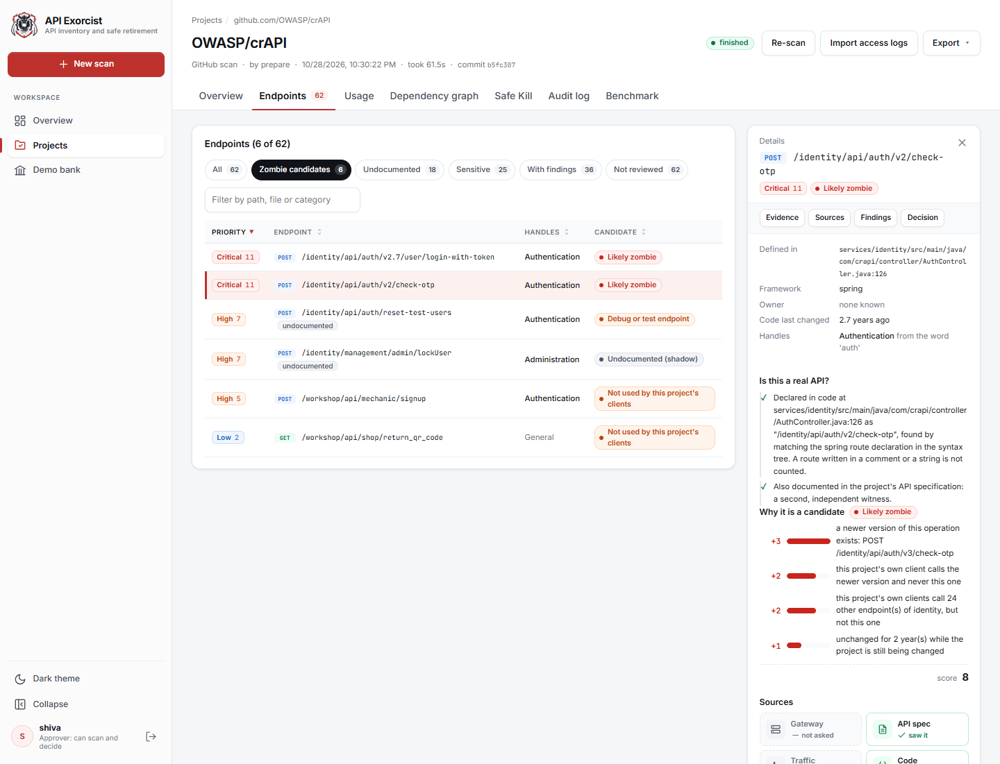

#### 4.8.2 Are the flagged endpoints really zombies?

This question has to be answered at two levels, because the system makes two kinds
of claim.

**Candidates from code.** On a repository the system never says an endpoint *is* a
zombie; it says it is a *suspected* one, and gives the reasons. What can be validated
is whether every reason it gives is true. Across the four repositories with
candidates there are 17 candidates carrying 25 stated reasons, and each reason was
checked against the project's own source: that the newer version exists, which
endpoints the project's own client code calls, what the specification documents, and
what the code says about the endpoint.

Table: Every zombie candidate on real code, its reasons checked against the source

| Repository | Candidate | Reasons given | Checked against the source | Assessment from reading the code |
|---|---|---|---|---|
| crAPI | `POST .../v2.7/user/login-with-token` | newer version exists; client calls only it; client calls 24 other identity endpoints | `v4.0` handler exists; the web app references only `v4.0` | Strong: an old authentication path left beside its replacement |
| crAPI | `POST .../v2/check-otp` | newer version exists; client calls only it; client calls 24 other identity endpoints | `v3` handler exists; the web app references only `v3` | Strong, and dangerous: the code's own comments say `v2` accepts any number of invalid OTPs, where `v3` invalidates the OTP after 10 |
| crAPI | `POST .../auth/reset-test-users` | debug or test endpoint; undocumented; but referenced by the project's chatbot (−2) | handler exists; not in the specification; referenced in `mcpserver/server.py` | A test-support endpoint shipped in production code, correctly scored down for its one caller |
| crAPI | `POST .../management/admin/lockUser` | undocumented while 22 of 32 identity endpoints are documented | absent from the specification | A shadow endpoint; undocumented, not necessarily unused |
| crAPI | `GET .../shop/return_qr_code`, `POST .../mechanic/signup` | the web app calls 13 other workshop endpoints but not these | no reference in the web app's source | Weak: other clients (mobile, partners) cannot be ruled out from code |
| VAmPI | `GET /users/v1/_debug`, `GET /createdb` | debug or test endpoint | the project's README lists them: one displays all user details, one recreates the database with dummy data | Strong: debug endpoints exposed in the API |
| spring-petclinic-rest | `GET /owners`, `GET /pets` | newer version exists | `/v2/owners` and `/v2/pets` are in the specification beside them | Strong: superseded by paged v2 |
| spring-petclinic-rest | `GET /oops` | debug or test endpoint | the specification describes it as an endpoint that always returns an error; no handler exists in the code | A debug endpoint, documented but not implemented in this version |
| fastapi template | `POST .../login/test-token`, `POST .../utils/test-email` | debug or test endpoint; generated client has it but no code calls it | no call outside the generated client | Strong: test endpoints served in production |
| fastapi template | `GET .../items/{id}`, `GET .../users/{user_id}`, `POST .../password-recovery-html-content/{email}` | generated client has it but no code calls it | no call outside the generated client | Weak: ordinary REST endpoints that an external API user may call |
| fastapi template | `POST /api/v1/private/users` | generated client has it but no code calls it | the front end calls the public `createUser`, never this one | The router is included only when `FASTAPI_ENV` is `development`; a development-only route, which code alone cannot tell |

**All 25 stated reasons are true in the source.** On reading the code, 10 of the 17
candidates are strong: a superseded version whose replacement the project's own
client uses, or a debug or test endpoint served in the API. One is a shadow endpoint
that is undocumented rather than unused. Six are weak, flagged only because the
project's own client does not call them. Those six are exactly the candidates the
ranking already places lowest (score 2), below every strong one, and they are
labelled *suspected* with the reason stated, which is the correct treatment of
evidence that an external caller could overturn. The reading of the code also found
one thing the scanner cannot see: a route registered only in a development
environment.

**Lifecycle labels.** A label of ZOMBIE is a claim about *use*, and use can only be
validated against traffic. That validation has been done where a known answer exists:

- on the hand-written estate, every one of the 8 zombies was found and no live
  endpoint was labelled ZOMBIE (Section 4.2);
- on 36 held-out generated estates, the learned model produced no false zombies and
  the rules fourteen, which is why the model holds a veto (Section 4.4);
- across 120 generated estates, the live endpoints that were nonetheless cleared for
  removal were all caught by Safe Kill before an outage (Section 4.6).

On a real project the same labels come from imported access logs, under three guards
against over-reading silence (Section 3.4.6). No public project publishes its
production logs, so that path has not been validated on real traffic in this work. A
pilot on a real estate's logs, with its engineers confirming or rejecting each label,
is the validation that remains, and is the first item of future work.

### 4.9 Comparative analysis: with and without API Exorcist

This section compares the position of an organisation that uses the system with one
that relies on what it already has. The comparison is with three alternatives:
managing endpoints by hand, a conventional inventory built from the API gateway and
the specification, and a static code scanner alone. Where a figure is quoted it was
measured in this chapter.

Table: Capabilities compared

| Capability | Manual management | Gateway + specification inventory | Static code scanner alone | API Exorcist |
|---|---|---|---|---|
| Finds endpoints the gateway and specification do not know | No | No: they are its blind spot | Yes, from code | Yes, from code, DNS and traffic together |
| Zombies found on the demo estate | Not measured | 2 of 8 | Cannot tell: no usage evidence | 8 of 8 |
| Tells an orphaned endpoint (in use) from a zombie | By judgement | No | No | Yes; usage counts against removal |
| Says what it cannot determine | No | No: a gateway alone classifies nothing and does not say so | No | Yes: rules abstain, verdicts can be indeterminate |
| Predicts what a removal would break | By judgement | No | No | Yes: blast radius, e.g. 9 services and 5 hops for one endpoint |
| Removes safely | Judgement, then removal | Judgement, then removal | Judgement, then removal | Shadow, named approval, canary, automatic rollback |
| Outages from removing the gate's 49 wrongly cleared live endpoints | 49 if removed on the gate's word | 49 | 49 | 0 |
| Explains and records each decision | Tickets, if kept | No | Findings only | Signed reasons per verdict; hash-chained audit log |
| Stops new zombies being created | Code review, if noticed | No | Partly, if run in CI | Yes: four rules on every pull request |

**What an organisation without it is left with.** Each consequence below is one this
work measured or observed:

1. **Most zombies stay invisible.** The inventory organisations actually have found
   2 of 8 zombies. The other six were invisible to both the gateway and the
   specification, and four of them carry no authentication at all.
2. **Dangerous legacy versions stay reachable.** OWASP crAPI still serves
   `v2/check-otp`, which accepts any number of invalid OTPs, beside the `v3` that
   locks after ten, while its own web application calls only `v3`. Nothing in a
   gateway-and-specification inventory marks the old one, because it is documented
   and registered. The system ranks it first.
3. **Debug and test endpoints ship and stay.** VAmPI's `_debug` (every user's
   details) and `createdb`, crAPI's `reset-test-users`, and the FastAPI template's
   `test-token` and `test-email` were all found in the APIs as served.
4. **Removal is a gamble.** On the gate's word alone, removal would have caused 49
   outages across 120 generated estates. A plain percentage canary avoids those
   outages only by luck: it refused 67 real requests along the way and wrongly kept
   118 dead endpoints running.
5. **Mistakes in either direction.** Removing an orphaned endpoint because nobody
   owns it is an outage; leaving a zombie because nobody is sure is open attack
   surface. Without usage evidence and the distinction between the two, both
   mistakes are made by judgement.
6. **No evidence for an audit.** The RBI framework requires an accurate inventory.
   Without the system there is no record of why an endpoint was kept or removed, by
   whom, or on what evidence.
7. **The problem keeps growing.** Without enforcement, each change can add an
   undocumented endpoint or remove a specification entry while leaving its handler,
   which is how every zombie in the simulated estate was made.

**What adopting it costs.** The comparison would be incomplete without the other
side. Safe removal is slow by design: ninety days of shadow and four weeks of canary
before an endpoint is gone, during which a dead endpoint stays up. Proving disuse on
real projects needs access logs, which must be exported from the gateway. The
learned model's veto occasionally keeps a genuine zombie for human review, as it did
for one endpoint on the demo estate. And a code scan sees only the frameworks it
covers. Each of these costs falls on the side of caution: the system can delay a
removal, but it does not make one that the evidence does not support.

### 4.10 Engineering quality

Table: Engineering quality measures

| Measure | Value |
|---|---|
| Automated tests (Python) | 307 tests |
| Dashboard tests (TypeScript, Vitest) | 48 |
| Ground-truth leakage guards | 3 |
| Continuous integration | Lint, strict type checking and tests on Python 3.10 and 3.12; dashboard build check; container build and smoke test; documented-figures check |
| Static typing | mypy in strict mode, clean |
| Container image | 53 MB, non-root, read-only filesystem |

**Security review of the system itself.** A system that holds a map of an estate's
weakest points is itself a target, so it was reviewed against the OWASP API Security
Top 10 [13] and NIST SP 800-95 [15] before release. The findings and fixes:

Table: Findings of the security review and their fixes

| Finding | Severity | Fixed by |
|---|---|---|
| A pull request could exempt its own endpoint by adding it to the policy file in the same change | High | The policy is read from the merge base; an edit is reported and applies after merge |
| Two simultaneous audit-log writers forked the hash chain | High | A cross-process lock and a flush to disk on every append |
| Starting on a non-loopback address would print a one-time token into container logs | Medium | Refused; configured tokens are required off loopback |
| CI actions referenced by movable tags; the scanner installed at whatever version was current | Medium | Actions pinned to commit hashes; exact scanner versions pinned |
| pip in the runtime image carried known vulnerabilities | Low | Removed from the image |
| Request bodies had no size limit | Low | 64 KiB cap; a body without a declared length is refused |

The concurrent-writer finding was measured, not assumed: four processes appending
twenty-five entries each at once broke the unlocked chain within its first
twenty-five entries in two runs of three; with the lock, all one hundred entries
verify on every run.

**Documentation that cannot drift.** Documentation drifted from the code three times
during the project. Tests check code against code, and nothing was checking the
figures written in documents. A claims verifier now recomputes every documented
figure and status marker from the running code, in both directions, and CI fails
when they disagree. This report is among the documents it checks.

### 4.11 Discussion against the objectives

Table: Objectives and results

| Objective (Section 1.3) | Result | Where |
|---|---|---|
| 1. Correlate six sources; classify in four states; abstain where evidence is missing | 0.960 accuracy, 0.940 macro-F1; gateway-only configuration classifies nothing and says so | 4.2, 4.3 |
| 2. Find more zombies than a conventional inventory, without marking a live endpoint for removal | 8 of 8 against 2 of 8; zombie recall 1.000; no live endpoint marked for removal | 4.2, 4.3 |
| 3. Review panel asks: dataset, focus domain, explainability | Generated estates by lifecycle mechanism with leakage guards; retail banking; SHAP and rule explanations in one format | 4.1, 4.4 |
| 4. Make removal safe, and measure it | 49 outages on the gate's word against 0 with Safe Kill, across 120 estates | 4.5, 4.6 |
| 5. Work on real code and be operable by a bank | Eight real repositories; endpoints validated against independent truth lists (126 of 127 agree, 167 of 167 traced to a declaration); all 25 candidate reasons true in the source; browser application, hardened container, CI enforcement | 4.7, 4.8, 4.10 |

Two results deserve emphasis because they were not the expected ones. The first is
that the design's own canary was not safe on the endpoints that actually reach it,
which was found by measuring it, and changed the architecture. The second is that
real repositories broke a scanner that passed every fixture test, which changed the
test strategy. In both cases the evidence was allowed to change the design rather
than the design being defended against the evidence.

**Summary.** On the synthetic estate the system classifies with 0.960 accuracy,
perfect zombie recall and no live endpoint marked for removal, and finds all eight
zombies where a conventional inventory finds two. The learned model produces no false
zombies on held-out estates where the rules produce fourteen, and is used as a veto.
Safe Kill takes removal on the gate's word from 49 outages to none, with the residual
risk measured and explained by the statistics of the shadow window. On eight real
repositories the scanner ranks first the endpoints the projects themselves show to be
stale, and says plainly when nothing distinguishes an endpoint. Validated against
lists built without it, its endpoints from code agree on 126 of 127 and every one
traces to a real declaration; every reason it gives for a zombie candidate is true in
the source, and the validation itself found and fixed two extraction defects. Compared
with what an organisation has without it, it finds the zombies a conventional
inventory misses, removes them without outages, and leaves an audit trail, at the
cost of a deliberately slow removal. The system is tested at four levels, reviewed
for its own security, and checked for drift between its documents and its code.

---

## Chapter 5: Advantages, Limitations and Applications

This chapter steps back from the measurements to assess the system as something a
bank would adopt. Section 5.1 sets out what it does better than the alternatives,
Section 5.2 states its limitations plainly, each with its consequence and what would
remove it, and Section 5.3 describes where it applies.

### 5.1 Advantages

1. **It finds what single-source tools cannot.** Correlating six sources found all
   eight zombies in the demo estate where a conventional gateway-plus-specification
   inventory found two; the six it adds were invisible to both authoritative sources,
   and four of them carry no authentication.
2. **It does not guess.** A rule whose source was never consulted abstains, a
   verdict with no evaluable rule is reported as indeterminate, and a scan of code
   alone never labels an endpoint a zombie. A partial deployment therefore reports
   what it cannot know instead of producing confident errors, which is what makes it
   deployable before every source is connected.
3. **It acts, safely.** Unlike detection tools that stop at a report, it carries a
   removal through a dependency check, a statistically sized shadow, a named
   approval, a staged canary and automatic rollback. Across 120 generated estates
   this took removal from 49 outages to none.
4. **Every decision is explainable and auditable.** Every verdict carries the signed
   evidence that produced it, model explanations use the same format as the rules,
   and every Safe Kill transition is written to a hash-chained log that a reviewer can
   verify in one click. This is the form a regulated audit asks for.
5. **It works on day one.** The rule layer needs no training data, so a new
   deployment classifies immediately; the learned model adds a veto where data
   exists, and can only make removal more conservative.
6. **It prevents new debt.** The CI action stops new shadow and zombie endpoints at
   the pull request that would create them, judging only what the change touches, so
   an estate with existing debt can adopt it immediately.
7. **It is cheap to adopt and to audit.** The core runs on the Python standard
   library; heavier components are optional; the dashboard's only runtime dependency
   is React; the container is small, unprivileged and read-only; and nothing from a
   scanned project is ever executed.
8. **It is honest about its own evidence.** Documented figures are checked against
   the running code on every build, and results that looked too good were
   investigated until they were explained.
9. **Its findings on real code are validated.** Against route lists built without
   it, its endpoints agree on 126 of 127 and every one traces to the line that
   declares it; every reason it gives for a zombie candidate is true in the source.

### 5.2 Limitations

1. **The lifecycle evaluation is on synthetic data.** Classification accuracy and the
   Safe Kill results are measured on generated estates with a known answer key,
   because no labelled corpus of zombie APIs exists. The claim is that the engine
   recovers known decay patterns from partial, disagreeing evidence, not that it has
   been validated on production bank traffic. A pilot on a real estate is the
   necessary next step (Chapter 6).
2. **Safe Kill's traffic is simulated.** The controller and its backend protocol are
   real; the gateway behind them in this work is a model whose assumptions are
   written down. A deployment replaces it with a gateway plugin implementing the same
   protocol.
3. **The guarantee is as strong as the shadow window.** The default catches a monthly
   caller with 95% confidence. A quarterly or annual job needs a longer window or a
   business-calendar check, and the evaluation shows a residual miss even at ninety
   days, caught by the canary.
4. **Isolation in the graph means no dependency was observed.** A caller silent during
   the capture window is invisible to the gate, which is why Safe Kill follows it.
5. **Code-only candidates are suspected, not proven.** Callers outside the
   repository, and URLs built at run time, cannot be seen from code; a gateway that
   rewrites paths can hide a front end's calls. Proof requires imported access logs,
   and those see only the traffic that passes where they are written. Conditions
   evaluated at run time are not seen either: the FastAPI template's private router,
   registered only in a development environment, is reported like any other route.
6. **Route extraction covers four frameworks.** FastAPI, Flask, Express and Spring
   are read from code; Django and Go routes are not yet, so their endpoints are seen
   only through a specification. The client reader does not follow URLs built by
   string concatenation, which understates front-end use in projects written that way.
   A Spring application's context path, set in `application.properties`, is not read,
   so a route the specification does not cover is shown without it.
7. **Ownership is read from CODEOWNERS and the specification only.** A repository
   with neither shows every endpoint in use as orphaned, which is correct by the
   definition but noisy until fixed.
8. **The API runs as a single replica.** Pending approvals are held in memory, so a
   restart forgets a candidate awaiting a decision and its shadow must run again.
   That can only delay a removal, never cause one; a database-backed queue is needed
   before a second replica.
9. **The audit chain proves tampering only when its head is anchored elsewhere.**
   Anyone able to rewrite the whole file can recompute the whole chain; the head hash
   must be shipped to a store the operator cannot write.
10. **Live website scanning is not available in this version.** It is designed with a
    passive tier and an ownership-gated active tier, and the application says it is
    not available rather than offering a weaker substitute.

### 5.3 Applications

- **Banking and financial services.** The intended setting: maintaining the accurate
  asset inventory the RBI's framework requires, reducing API attack surface, and
  giving auditors a verifiable record of why each endpoint was kept or removed.
- **API security and attack-surface management.** Finding shadow and zombie
  endpoints, which OWASP ranks among the top ten API risks, and prioritising them by
  the data they handle.
- **Platform engineering and API governance.** Running decommissioning as a routine,
  low-risk process rather than an occasional project, and enforcing documentation
  and ownership on every pull request.
- **Cloud and microservice migration.** Establishing what an estate actually serves
  and what depends on what before services are moved, merged or retired.
- **Mergers and acquisitions.** Inventorying an acquired organisation's APIs, whose
  documentation is least likely to be current.
- **Security audits and compliance reviews.** Exporting findings as SARIF for
  code-scanning tools and as CSV for governance, risk and compliance systems, with an
  executive report for management.
- **Education and research.** The labelled estate generator and the evaluation
  harness are reusable for research on API lifecycle analysis, where no public
  dataset exists.

**Summary.** The system's advantages are that it finds what single-source tools
miss, refuses to guess where evidence is missing, removes safely and auditably, works
without training data, and prevents new debt in CI. Its main limitations are that the
lifecycle evaluation is synthetic, that removal safety depends on an observation
window that rare callers can outlast, and that code alone cannot prove disuse. It
applies wherever an organisation must know and control its API surface, most
directly in regulated banking.

---

## Chapter 6: Conclusion and Future Scope

### 6.1 Conclusion

This project set out to solve a problem that is easy to state and hard to act on:
banking API estates accumulate endpoints that are still reachable but no longer serve
any purpose, and no single source of evidence can say which ones they are. The work
reported here shows that the problem yields to correlation. Six partial witnesses
that individually cannot identify an abandoned endpoint can identify it jointly,
because what marks a zombie is a pattern of disagreement between them: present in
code, still resolvable, unknown to the gateway and the specification, and silent in
traffic.

Five conclusions follow from the results.

**First, correlation outperforms the inventory organisations actually have.** On the
synthetic estate, a conventional gateway-plus-specification inventory found two of
eight zombies; correlating six sources found all eight, with 0.960 accuracy, 0.940
macro-F1 and no live endpoint marked for removal. The conventional inventory's
failure was one of visibility, not judgement.

**Second, a system that cannot see should say so.** Treating an unconsulted source as
absent evidence would have made every repository scan declare every endpoint dead.
Abstention, indeterminate verdicts, and the refusal to label anything a zombie from
code alone are what make the system usable before every source is connected.

**Third, the asymmetry of errors should shape the architecture.** A false zombie is
an outage; a missed one is a line on a report. That asymmetry is why the learned
model, which produced no false zombies on held-out estates where the rules produced
fourteen, is a veto and never a proposer, and why the rules, which need no training
data and can be audited line by line, remain the day-one classifier.

**Fourth, safe removal has to be measured, not assumed.** The removal gate, which
requires both the classifier and the dependency graph to agree, still cleared 49 live
endpoints across 120 generated estates, because rarely used endpoints leave no trace
in the graph. Measuring the design's canary showed it was blind on exactly those
endpoints. The resulting Safe Kill controller, with a shadow window sized by the rule
of three, took outages from 49 to none, and the residual risk it carries is
quantified and explained rather than hidden.

**Fifth, real code is the test that matters.** Scanned from GitHub, the system ranks
first the endpoints that real projects themselves show to be stale, including the
two old authentication endpoints OWASP crAPI still serves beside their replacements.
Testing on real repositories also broke a scanner that had passed every fixture
test, and each failure it exposed was fixed. Validated against route lists built
without it, the scanner's endpoints agree on 126 of 127 and every one traces to a
real declaration, and every reason it gives for a zombie candidate is true in the
project's source.

The objectives set in Chapter 1 have been met. The project's contribution is not any
single technique but their composition into a system that can safely act: multi-source
correlation to establish a status no single source can determine, dependency-aware
prediction of consequence, an observed and reversible removal process, and complete
explanation of every decision. The boundary of the claim is stated as carefully as
the claim: the architecture and the analysis are real, the repository scans are of
real projects, and the lifecycle evaluation is on a synthetic estate with a known
answer key.

### 6.2 Future scope

1. **A pilot on a real estate.** The most important next step is to run the system
   against a real organisation's gateway logs and repositories, with its engineers
   confirming or rejecting each finding, to measure precision on production data.
2. **Gateway plugins.** Implement the enforcement backend for Kong, Envoy and a cloud
   API gateway, so that Safe Kill's shadow and canary act on real traffic, answering
   `410 Gone` reversibly at the gateway.
3. **Business-calendar-aware shadow windows.** Extend the window beyond a fixed
   slowest caller, using deployment calendars and historical logs to catch quarterly
   and annual jobs.
4. **Wider framework coverage.** Add route extraction for Django, Go, ASP.NET and
   NestJS, and teach the client reader to follow URLs built by string concatenation.
5. **Durable, multi-replica operation.** Move pending approvals into a database so
   the service can run as more than one replica, and anchor the audit chain's head in
   write-once storage or the bank's SIEM.
6. **Live website scanning.** Ship the designed two-tier scanner: passive discovery
   from public records for any site, and active probing only after DNS proof of
   ownership.
7. **Continuous operation.** Re-scan on every merge and every log rotation, alerting
   on drift: new undocumented endpoints, new candidates, and endpoints whose last
   caller has gone quiet.
8. **Research.** Publish the generator and evaluation harness as a benchmark for API
   lifecycle analysis, and study how well lifecycle state can be inferred from partial
   evidence across organisations with different observation practices.

---

## References

[1] D. Caivano, P. Cassieri, S. Romano, and G. Scanniello, "On the spread and evolution of dead methods in Java desktop applications: an exploratory study," *Empirical Software Engineering*, vol. 28, no. 3, art. 64, 2023, doi: 10.1007/s10664-023-10303-0.

[2] P. Cassieri, S. Romano, and G. Scanniello, "On deprecated API usages: an exploratory study of top-starred projects on GitHub," in *Proc. 24th Int. Conf. Product-Focused Software Process Improvement (PROFES)*, 2023, doi: 10.1007/978-3-031-49266-2_29.

[3] V. Bushong, D. Das, A. Al Maruf, and T. Cerný, "Using static analysis to address microservice architecture reconstruction," in *Proc. 36th IEEE/ACM Int. Conf. Automated Software Engineering (ASE)*, 2021, doi: 10.1109/ASE51524.2021.9678749.

[4] S.-P. Ma, C.-Y. Fan, Y. Chuang, I-H. Liu, and C.-W. Lan, "Graph-based and scenario-driven microservice analysis, retrieval, and testing," *Future Generation Computer Systems*, vol. 100, pp. 724–735, 2019, doi: 10.1016/j.future.2019.05.048.

[5] A. S. Abdelfattah and T. Cerný, "The microservice dependency matrix," in *Proc. European Conf. Service-Oriented and Cloud Computing (ESOCC)*, 2023, doi: 10.1007/978-3-031-46235-1_19.

[6] G. Dell'Immagine, J. Soldani, and A. Brogi, "KubeHound: detecting microservices' security smells in Kubernetes deployments," *Future Internet*, vol. 15, no. 7, art. 228, 2023, doi: 10.3390/fi15070228.

[7] F. L. Ponce Mella, J. Soldani, C. Taramasco, H. Astudillo, and A. Brogi, "Beyond security: understanding the multiple impacts of security smells for microservices," *CLEI Electronic Journal*, vol. 27, no. 2, 2024, doi: 10.19153/cleiej.27.2.6.

[8] S. M. Lundberg and S.-I. Lee, "A unified approach to interpreting model predictions," in *Advances in Neural Information Processing Systems (NIPS)*, 2017.

[9] D. Gaspar, P. Silva, and C. Silva, "Explainable AI for intrusion detection systems: LIME and SHAP applicability on multi-layer perceptron," *IEEE Access*, vol. 12, 2024, doi: 10.1109/ACCESS.2024.3368377.

[10] Q. Scheitle, O. Gasser, T. Nolte, J. Amann, L. Brent, G. Carle, R. Holz, T. C. Schmidt, and M. Wählisch, "The rise of certificate transparency and its implications on the internet ecosystem," in *Proc. Internet Measurement Conference (IMC)*, 2018.

[11] G. Brito, A. Hora, M. T. Valente, and R. Robbes, "On the use of replacement messages in API deprecation: an empirical study," *Journal of Systems and Software*, vol. 137, pp. 306–321, 2018, doi: 10.1016/j.jss.2017.12.007.

[12] M. E. Gortney, P. E. Harris, T. Cerný, A. Al Maruf, M. Bures, D. Taibi, and P. Tisnovsky, "Visualizing microservice architecture in the dynamic perspective: a systematic mapping study," *IEEE Access*, vol. 10, pp. 119999–120012, 2022, doi: 10.1109/ACCESS.2022.3221130.

[13] OWASP, "API9:2023 Improper Inventory Management," *OWASP API Security Top 10*, 2023.

[14] Reserve Bank of India, "Cyber Security Framework in Banks," DBS.CO/CSITE/BC.11/33.01.001/2015-16, 2016.

[15] National Institute of Standards and Technology, "Guide to Secure Web Services," NIST SP 800-95, 2007.

[16] IEEE, "IEEE Standard for Information Technology—Systems Design—Software Design Descriptions," IEEE Std 1016-2009, 2009.

[17] R. Fielding, M. Nottingham, and J. Reschke, "HTTP Semantics," IETF RFC 9110, 2022.

[18] S. Dalal and E. Wilde, "The Deprecation HTTP Response Header Field," IETF RFC 9745, 2025.

[19] E. Wilde, "The Sunset HTTP Header Field," IETF RFC 8594, 2019.

[20] OpenAPI Initiative, "OpenAPI Specification," version 3.1.0, 2021.

[21] OASIS, "Static Analysis Results Interchange Format (SARIF)," version 2.1.0, OASIS Standard, 2020.

[22] ISO/IEC/IEEE, "Software and systems engineering—Software testing—Part 1: General concepts," ISO/IEC/IEEE 29119-1:2022, 2022.

[23] IEEE, "IEEE Standard for System, Software, and Hardware Verification and Validation," IEEE Std 1012-2016, 2016.

[24] J. Arkko, M. Cotton, and L. Vegoda, "IPv4 Address Blocks Reserved for Documentation," IETF RFC 5737, 2010.

[25] Prometheus Authors, "Exposition formats," Prometheus documentation, The Linux Foundation.

---

## Appendix A: Soft Code Flowcharts

This appendix gives the flowcharts and algorithm listings for the parts of the
system not already drawn in Chapter 3.

**A.1 Data flow.** The level-1 data flow diagram shows how signals move from the six
sources through correlation, classification, the graph and the removal gate to the
operator.

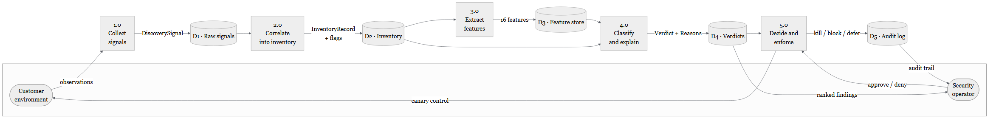

**A.2 Scanning a real repository.**

```
DEFINE scan_repository(link or uploaded folder):
  checkout  <- clone with history (GitHub) or copy (upload); never execute anything
  routes    <- Semgrep AST rules over FastAPI, Flask, Express and Spring sources
               compose router and mount prefixes; normalise path parameters
               mark a route unresolved where its prefix cannot be known
  spec      <- every committed OpenAPI or Swagger document, parsed as data
  history   <- one `git log` pass: days since each handler file last changed
  owners    <- CODEOWNERS and `x-owner` in the specification
  clients   <- calls the project's own front end, SDK and services make
  graph     <- service-to-service calls, gateway routes and message topics
  record "what was checked": worked / partly / not available / failed, with reasons
  inventory <- correlate(CODE, OPENAPI, CICD signals)       -- no lifecycle claim
  candidates <- score each endpoint by the signals of Section 3.4.5
  RETURN report(counts, checks, candidates, endpoints, graph)
```

**A.3 Enforcement on a pull request.**

```
DEFINE enforce(repository, base_ref):
  merge_base <- git merge-base(base_ref, HEAD)
  policy     <- .apix.yml as it is AT merge_base           -- a change cannot exempt itself
  before     <- surface(merge_base)   -- routes, spec entries, owners
  after      <- surface(HEAD)
  findings   <- []
  FOR route IN after.routes - before.routes:
    IF route not in after.spec:          ADD "undocumented endpoint"
    IF route has no owner:               ADD "unowned endpoint"
  FOR entry IN before.spec - after.spec:
    IF entry's handler still in after.routes: ADD "zombie in the making"
  FOR entry IN after.spec - before.spec:
    IF no handler implements entry:      ADD "documented, not implemented" (warning)
  REMOVE findings exempted by policy (each exemption must carry a reason)
  EMIT annotations on the changed lines; EXIT 0 clean, 1 findings, 2 cannot run
```

**A.4 Scanning a live website.** Designed but not shipped in this version, the
scanner is split into a passive tier that may run against any address and an active
tier that unlocks only after the owner proves control of the domain.

")

---

## Appendix B: Data Sheets

As a software project, the data sheets of this system are the specifications of its
rules, signals, features and interfaces.

**B.1 The fifteen evidence rules.** Weights are per class: positive supports the
class, negative counts against it. A rule is evaluated only when the sources it
requires were consulted.

Table: The fifteen evidence rules and their weights

| Rule | Requires | ACTIVE | DEPRECATED | ORPHANED | ZOMBIE |
|---|---|---:|---:|---:|---:|
| No meaningful traffic in the window | TRAFFIC | −3.0 | +0.5 | −2.5 | +3.5 |
| Serving real traffic above the threshold | TRAFFIC | +2.0 | +1.0 | +1.5 | −3.5 |
| Absent from both specification and gateway | OPENAPI, GATEWAY | −2.0 | −1.5 | | +2.5 |
| Handler in code but undocumented | CODE, OPENAPI | −1.0 | −1.0 | | +1.0 |
| In both specification and gateway | OPENAPI, GATEWAY | +1.5 | | | −1.5 |
| Marked deprecated in the specification | OPENAPI | −2.5 | +5.5 | | −0.5 |
| No owning team | any of CODE, OPENAPI, CICD | −2.0 | | | +0.8 |
| Carrying real traffic with no owner | TRAFFIC and an ownership source | | | +3.5 | −1.0 |
| An owning team is recorded | any of CODE, OPENAPI, CICD | +1.2 | +0.5 | −3.0 | |
| No meaningful use for over six months | TRAFFIC | −2.0 | | −1.5 | +2.0 |
| Used within the last 30 days | TRAFFIC | +1.5 | | +1.0 | −2.0 |
| Resolvable via DNS despite no traffic | DNS, TRAFFIC | | | | +1.5 |
| No commit to the handler in over a year | CODE | −0.8 | +0.5 | | +1.0 |
| No CI/CD pipeline record | CODE, CICD | −0.8 | | | +1.2 |
| Other services observed calling it | TRAFFIC | +1.2 | | +1.0 | −1.5 |

**B.2 The fourteen discrepancy flags.**

Table: The fourteen discrepancy flags

| Flag | Raised when |
|---|---|
| `UNDOCUMENTED` | the handler exists in code and the specification does not describe it |
| `UNREGISTERED` | the handler exists in code and the gateway has not registered it |
| `SHADOW_CANDIDATE` | neither the specification nor the gateway knows it |
| `NO_TRAFFIC_IN_WINDOW` | traffic capture never observed it |
| `EFFECTIVELY_SILENT` | observed, but below ten calls a day |
| `STALE_6M` | last meaningful use over 180 days ago, or never |
| `NO_OWNER` | no owning team could be determined |
| `REACHABLE_BUT_UNUSED` | DNS resolves it and traffic never observed it |
| `UNAUTHENTICATED` | no authentication |
| `LEGACY_AUTH` | API-key authentication |
| `SENSITIVE_DATA` | handles personal or financial data |
| `MARKED_DEPRECATED` | the specification marks it deprecated |
| `CODE_UNTOUCHED_1Y` | no commit to its handler in over 365 days |
| `NO_PIPELINE_RECORD` | in code, but no pipeline record of its deployment |

**B.3 The sixteen features of the learned model.** All are observable; the label is
attached afterwards and is never an input.

Table: The sixteen observable features

| Group | Features |
|---|---|
| Visibility and documentation | in OpenAPI specification; in gateway registry; handler exists in code; deployed via pipeline; number of sources that saw it |
| Reachability | DNS resolvable |
| Usage | observed on the wire; daily calls (log-scaled); days since last use; distinct callers |
| Ownership | has owner |
| Lifecycle | specification deprecated; days since last commit |
| Security posture | unauthenticated; legacy authentication; handles sensitive data |

**B.4 The REST API.** Every route except the first requires a bearer token.

Table: REST API routes and the role each requires

| Route | Role | Returns or does |
|---|---|---|
| `GET /v1/health` | none | status and version, nothing about the estate |
| `GET /v1/summary` | viewer | counts, scan time, and the simulated-mode notice |
| `GET /v1/inventory`, `/v1/verdicts`, `/v1/impact`, `/v1/benchmark` | viewer | the inventory, verdicts, gate and comparison, as JSON |
| `GET /v1/safekill`, `/v1/audit`, `/v1/audit/verify` | viewer | Safe Kill state, the audit chain, its verification |
| `POST /v1/safekill/shadow` | approver | run the gate and the shadow window for one candidate |
| `POST /v1/safekill/decision` | approver | approve or decline; the canary and rollback follow |
| `POST /v1/demo/rescan` | approver | re-run discovery on the demo bank |
| `GET /v1/capabilities` | viewer | which scan inputs work on this machine, and why not |
| `POST /v1/scans/upload`, `POST /v1/scans/github` | approver | start a scan of an uploaded folder or a GitHub link |
| `GET /v1/scans`, `GET /v1/scans/{id}` | viewer | every scan; one scan's progress, report and decisions |
| `GET /v1/scans/{id}/audit` | viewer | that scan's hash-chained audit log |
| `POST /v1/scans/{id}/review` | approver | record a decision about an endpoint a scan found |
| `GET /v1/demo/graph` | viewer | the demo bank's dependency graph |
| `GET /metrics` | viewer | Prometheus metrics |

**B.5 Operational metrics.**

Table: Prometheus metrics exposed by the service

| Metric | Answers |
|---|---|
| `apix_http_requests_total`, `apix_http_request_duration_seconds` | traffic and latency, by route template |
| `apix_auth_failures_total` | missing, unrecognised or under-privileged credentials |
| `apix_safekill_actions_total` | shadows started; decisions approved, declined or refused |
| `apix_endpoints`, `apix_removal_candidates`, `apix_cleared_by_gate` | the estate, as the last scan saw it |
| `apix_safekill_awaiting_approval` | removals waiting on a person |
| `apix_audit_entries`, `apix_audit_chain_ok` | whether the audit chain still verifies |

**B.6 Configuration.**

Table: Configuration settings

| Variable | Default | Meaning |
|---|---|---|
| `APIX_DATA_DIR` | `./data` | where reports, the audit log and scans are kept |
| `APIX_BUS` | `local` | message transport: `local` or `kafka` |
| `APIX_GRAPH` | in-memory | dependency graph backend: in-memory or `neo4j` |
| `APIX_TRAFFIC_WINDOW_DAYS` | 30 | the capture window traffic is reported over |
| `APIX_TRAFFIC_THRESHOLD` | 10 | calls a day below which use is not meaningful |
| `APIX_API_TOKENS` | none | named principals: `name:role:sha256;...` |
| `APIX_LOG_FORMAT` | text | `json` for structured logs |

---

## Appendix C: List of Components

The project has no hardware components. Its software components are listed below;
everything beyond the core is an optional extra, installed only by the deployments
that use it.

Table: Software components

| Component | Version | Purpose | Required |
|---|---|---|---|
| Python | 3.10 or later | the system's language and runtime | yes |
| Semgrep | 1.100 or later | AST-level route extraction from source code | for scanning real projects |
| git | any current | cloning repositories with history | for GitHub scans |
| PyYAML | 6.0 or later | parsing committed OpenAPI documents | for scanning real projects |
| FastAPI, Uvicorn | 0.110, 0.29 or later | the REST API and its server | for the application |
| python-multipart | 0.0.18 or later | folder uploads | for the application |
| React, React DOM | 19 | the dashboard | built into the package |
| Inter, JetBrains Mono (Fontsource) | 5 | the dashboard's typefaces, bundled so the CSP needs no external origin | built into the package |
| TypeScript, Vite, Vitest | 7, 8, 4 | dashboard language, build and tests | development only |
| scikit-learn, pandas | 1.4, 2.0 or later | the learned model | for the model layer |
| SHAP | 0.45 or later | model explanations | for the model layer |
| Neo4j driver | 5.0 or later | the graph backend | optional |
| kafka-python, Elasticsearch client | 2.0, 8.0 or later | production transport | optional |
| pytest, ruff, mypy, pre-commit | 8.0, 0.6, 1.11, 3.7 or later | tests, lint, strict typing, commit hooks | development only |
| Docker | any current | the deployable container image | for deployment |
| GitHub Actions | | continuous integration; the enforcement action | for CI |

---

## Appendix D: List of Papers Presented and Published

<!--
Update this when the paper is submitted or accepted. Do not list it as
submitted, accepted or published without the proof the guidelines ask for
(proof of submission, acceptance letter, or the published version).
-->

Table: Research paper status

| Title | Authors | Format | Status |
|---|---|---|---|
| Evidence Before Removal: Discovering and Safely Retiring Zombie and Shadow APIs | Shivansh Jindal, Dhyey Kharayat, Nakul Hintya, Dr. Pintu R Shah | IEEE conference format | Draft ready; not yet submitted |

The paper reports the work of this project in the form of a conference paper:
the evidence-correlation inventory with abstaining rules, the Safe Kill removal
pipeline and its rule-of-three shadow window, and the evaluation on the simulated
banking estate, 120 generated estates and public repositories. It has been
prepared in full and has not yet been submitted to a journal or conference.
Proof of submission will be attached here once it is submitted.
